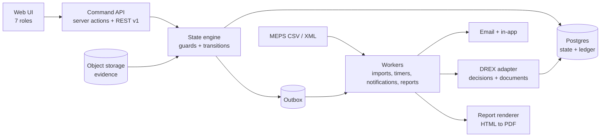
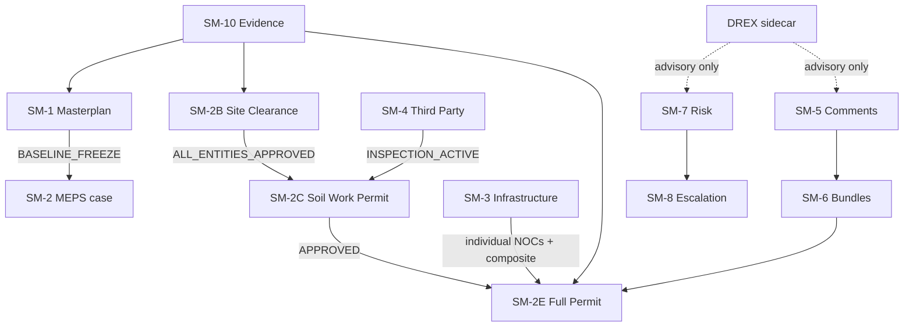
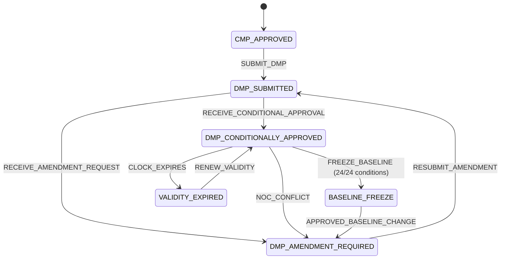
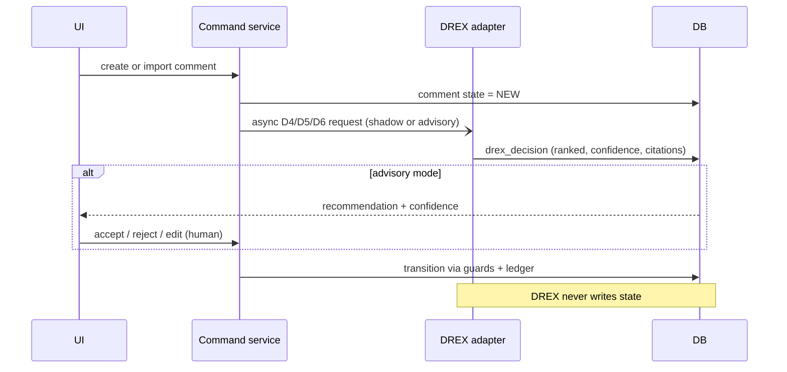
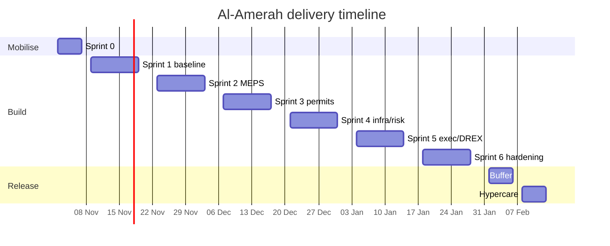

# Al-Amerah Stakeholder Permitting & Automated Governance Dashboard

## Execution Plan — Sprints, State Machines, Eval Loops, DREX Integration

**Version:** 1.2 — W1 software-contract reconciliation  
**Date:** 2 November 2026  
**Product owner:** Stakeholder Coordination Manager  
**Build owner:** Engineering lead  
**Sources:** PRD plus AOR strategy, XLSX tracker, process presentation, DMT letter and signed Form 22; provenance and conflicts in §9.  
**Companion file:** [`state-machines.yaml`](./state-machines.yaml) — the machine-readable contract used to generate code, tests, and diagrams.

**Contents:** 0. Summary · 1. Architecture · 2. State machines · 3. Eval loops · 4. DREX integration · 5. Sprint plan · 6. Definition of Done · 7. Risks · 8. Client inputs · 9. Source reconciliation · Appendices A–D.

---

## 0. One-page summary

This is not a spreadsheet with a nicer UI. It is a **state-driven permitting control tower** where:

1. Every regulated record has an explicit state, and every state change goes through one command path: **authorize → validate → guard → transition → ledger → event**.
2. Four PRD engines are implemented exactly as named, plus seven supporting machines needed to make them operable and auditable (20 executable machine definitions once lanes and child aggregates are separated).
3. The two acceptance criteria that matter most — **100% MEPS reconciliation** and **hard locks that cannot be bypassed** — are release gates, not demo bullet points.
4. DREX (Nace AI) is used as a **typed decision sidecar**: it scores options, never writes text and never changes state. It runs in **shadow** first, then **advisory**, and never autonomous.
5. Delivery is **14 working weeks plus 1 buffer week**: 1 week mobilise, 6 two-week sprints, 1 week hypercare, then 1 week of buffer if needed.

### What success looks like on day one of go-live

| Outcome | Measurable definition |
|---|---|
| One source of truth | No status is entered twice; MEPS import reconciles at 100% on the release extract |
| No illegal shortcut | Step 02B, Step 04 and inspection tasks cannot be released while their gates are open — proven by tests, not policy |
| Every blocker has an owner | Each open risk/comment has an owner, due date, aging clock and escalation level |
| Executive visibility | A full AOR health report is generated from live data in under 60 seconds |
| Audit-ready | Every mutation has actor, role, before/after, reason, evidence and hash-chained timestamp |
| AI is safe | DREX recommendations are logged, cited, confidence-scored, overridable and structurally incapable of causing a transition |

### Scope tiers

| Tier | Includes | When |
|---|---|---|
| **Core (must ship)** | SM-1 Masterplan, SM-2 MEPS family, SM-5 Comments, SM-6 Bundles, SM-10 Evidence, RBAC, audit ledger, approvals tracker, comment register, Step 04 readiness gate, executive summary, escalation rules 1–3, MEPS importer | Sprints 0–4 |
| **Full PRD (v1.0)** | + SM-3 Infrastructure, SM-4 Third-party, risk module, escalation rule 4, PDF report generator, all KPIs, DREX advisory | Sprints 4–6 |
| **Later (v1.1+)** | GIS map editing, full Arabic RTL UI, e-signature, MEPS write-back/RPA, mobile app, predictive analytics | Post-hypercare |

### What I will deliberately not build in v1

- No direct write-back to MEPS/TAMM. v1 is **import + evidence + control**, not an authority system replacement.
- No AI auto-approval, auto-waiver or auto-submission.
- No free-text generation by DREX. Letters and reports are **deterministic templates** bound to audited data.
- No GIS editing. The DMP geometry is consumed as a reference layer.
- No fee payment processing. Fees are tracked as a status, not transacted.
- No e-signature. Signed documents are uploaded and hash-verified.

---

## 1. Architecture and delivery model

### 1.1 Stack

| Layer | Choice | Why | Alternative |
|---|---|---|---|
| Web app | Next.js 15 (App Router) + TypeScript | Server actions for commands, fast dashboards, one deployable | Remix |
| UI | Tailwind + shadcn/ui + Recharts | Fast, accessible, consistent; no bespoke design system needed | MUI |
| Database | PostgreSQL 16 + Drizzle ORM | Relational integrity for states, evidence and audit; strong constraints | SQL Server |
| Auth | Auth.js + Azure AD SSO + MFA for admins | Client/AOR tenant and federation confirmed in S0; scoped role claims | Supabase Auth |
| Jobs | Inngest (or pg-boss) | Durable timers, retries, scheduled escalations, imports, reports | BullMQ |
| Storage | S3-compatible object storage, versioned + object lock | Immutable evidence, signed URLs, retention | Azure Blob |
| Documents | Nace Document Intelligence (parse/split/classify/extract/ground) | Grounded field extraction from NOCs and stamped drawings | Adobe PDF Extract |
| Decisions | Nace DREX (`/v1/systemone`) | Typed option scoring, probabilities, sub-200ms, no free text | Rules baseline |
| Tests | Vitest, Playwright, fast-check, Testcontainers | Unit, E2E, property-based, real Postgres | — |
| Observability | OpenTelemetry + Sentry + structured logs | Trace every command and timer; correlate incidents | Datadog |
| Email | Resend or SES | Templates + delivery webhooks | SMTP |
| Deployment | Docker on Azure UAE North (recommended) | Data residency and client procurement fit | Vercel + Neon for a pilot only |

**Decision gate (Sprint 0):** confirm data classification and residency. If client data cannot leave UAE, deploy the app in Azure UAE North and use either Nace dedicated deployment in our Azure subscription or self-hosted Drex 2.0. If a pilot is allowed, hosted DREX with redacted text is acceptable for build and shadow evaluation.

### 1.2 System shape



### 1.3 The write path (non-negotiable)

Every mutation uses the same path:

```
UI / API
  → command schema validation (Zod)
  → server-side authorization (role + scope + segregation of duties)
  → load aggregate + expected version
  → evaluate guards against current facts
  → write transition + state + audit ledger + outbox in ONE transaction
  → return new state + allowed next events
```

Rules:

1. **No direct writes to state columns.** Not from the UI, not from scripts, not from admins.
2. **Optimistic concurrency.** Every aggregate has `version`; stale commands return `409`.
3. **Idempotency key required** on every command. Retries must not duplicate transitions.
4. **Derived states are computed, not stored.** Example: `ALL_ENTITIES_APPROVED` is derived from child entity states.
5. **Timers are durable jobs.** No `setTimeout`, no in-memory cron.
6. **State machines are versioned.** In-flight cases pin a `machine_version`; upgrades are explicit migrations.
7. **Admin override is data correction, not gate bypass.** A gate can only be cleared by evidence or a formal `WAIVE` with authority confirmation and executive approval. Both are dual-control and audited.

### 1.4 Core data model

| Group | Tables |
|---|---|
| Project baseline | `project`, `parcel`, `baseline_version`, `baseline_change_request`, `masterplan_condition`, `condition_evidence` |
| Identity | `user`, `organization`, `role_assignment`, `permission_scope`, `session` |
| Evidence | `document`, `document_version`, `document_link`, `document_extraction`, `evidence_validation` |
| MEPS | `meps_case`, `meps_step`, `authority_application`, `authority_entity_status`, `application_event` |
| Comments | `comment`, `comment_response`, `resubmission_bundle`, `bundle_item` |
| Deliverables | `package`, `deliverable`, `deliverable_revision`, `readiness_gate`, `gate_check` |
| Infrastructure | `infra_program`, `infra_step`, `infra_dependency` |
| Third party | `third_party_authorization`, `inspection_assignment`, `inspection_signoff` |
| Risk | `risk`, `risk_action`, `escalation`, `notification` |
| Audit | `state_transition`, `domain_event`, `outbox`, `audit_export` |
| Reporting | `kpi_snapshot`, `report`, `report_snapshot` |
| DREX | `drex_decision`, `drex_feedback`, `drex_option_set`, `drex_eval_run` |
| Import | `import_batch`, `import_row`, `reconciliation_run`, `sla_config` |

Key database constraints:

- `unique (authority, application_ref)` and `unique (parcel_id, permit_type)` for active cases.
- `masterplan_condition` count check = 24 for the active DMP version.
- `state_transition` is append-only; no update or delete grants for the app role.
- `document_version` is immutable; a new revision creates a new row.
- `baseline_version` is immutable after freeze; changes create a new version.
- Partial unique index: one `INSPECTION_ACTIVE` authorization per project and discipline.

**Baseline facts to ingest (from the PRD):**

| Field | Value |
|---|---|
| Development reference | Al-Amerah Zone 1 |
| Site area | 5,932,872 m² |
| Total GFA | 2,274,512 m² |
| Residential GFA | 2,185,200 m² |
| Residential units | 2,428 — Area-01 1,002; Area-02 837; Area-03 511; Area-04 78 |
| Commercial GFA | 19,057 m² |
| Community facilities GFA | 70,255 m² |
| Masterplan certificate | MPD-230126-0505 / DMT/MD/OUT/2026/4886 |
| Validity | 4 June 2026 to 4 June 2029 |

### 1.5 Integration boundaries

| Boundary | Direction | Contract | Failure mode |
|---|---|---|---|
| MEPS/TAMM | In | CSV/XML upload; saved column mappings; staged diff; commit | Manual entry form with identical validation |
| Object storage | In/Out | Signed URL, SHA-256 hash, scan status, version | Quarantine upload; block as evidence |
| Email/SMS | Out | Templated notification + delivery webhook | In-app fallback + retry with backoff |
| DREX decisions | Out/In | `POST /v1/systemone`; typed questions; probabilities | Rules fallback; recommendation suppressed |
| DREX documents | Out/In | Async parse/classify/extract/ground jobs | Manual metadata entry |
| Reports | Out | HTML → PDF; snapshot + hash | CSV/JSON export |

### 1.6 RBAC and segregation of duties

Permissions are the intersection of the exact YAML transition role list, scope/assignment, local guards and the mandatory global evidence/dual-control policy. A broad job title grants no direct state-entry or technical validation right. The detailed seven-role capability matrix is in [`execution/IMPORT_EVIDENCE_RBAC_SPEC.md`](./execution/IMPORT_EVIDENCE_RBAC_SPEC.md); this summary supersedes the former broad editor table.

| Capability | Permission boundary |
|---|---|
| Read / stage source data | Verified project/discipline/package scope; staging never authorizes a workflow transition |
| Record authority receipts / approvals | Exact transition roles and evidence guards; recording is not independent validation or external submission |
| Validate authority/NOC/legal evidence | Different eligible Stakeholder Manager; verified named assignment and scope |
| Validate structural stamped evidence | Different assigned credentialed Third-Party Inspector; active authorization and scope |
| Comment triage / draft | Exact SM-5 transition roles; inspector technical review and contractor supplied evidence are not blanket lifecycle permissions |
| Close authority comment | SM-5 `CLOSE`: AOR Lead or Stakeholder Manager plus authority closure evidence; no inspector/contractor/discipline closure permission |
| Freeze baseline | SM1-T04 role/guard and dual-control requirements; no blanket admin freeze permission |
| Waive / mark not required / exempt | Each specific transition's role combinations, authority evidence, independent validation and dual control; no generic waive-any-gate command |
| Manage users/config | System Admin; cannot grant self an authority approval or bypass technical validation |
| Correct facts | Admin appends independently approved regulated corrections; no direct state edit, deletion or gate clearing |
| Reports / escalation | Exact SM-7/8/9 transition permissions and scoped read access; report visibility is not publication permission |
| Permit issuance | Contractor is issuing party; authorized AOR/manager recording remains separate from issuance identity and current gate eligibility |

Rules that the tests must enforce:

**Seventh role — `CONTRACTOR`:** assigned-package read access; registration/site-clearance actions only where permitted by the YAML; appointment evidence and contractor issuance recording. No design editing, comment closure, waiver, baseline freeze or evidence self-validation. Test alongside all six other human roles. AOR may record issuance but cannot impersonate the issuing party.

1. **AOR cannot self-approve.** Recording an authority approval is a data entry; validating it is a separate permission held by the Stakeholder Manager or the third-party inspector where structural.
2. **Qualiconsult cannot edit design documents.** It can review, stamp and sign off structural items; it cannot change the drawing.
3. **SysAdmin has no blanket freeze/waiver right.** Correction is append-only; specific regulatory transitions require their declared eligible actors, authority evidence and dual control. A role combination never overrides those declarations.
4. **Client Executive cannot edit trackers.** The executive role approves escalations, waivers and baseline changes; it does not enter status.
5. **Every denial is tested.** The RBAC matrix is generated and asserted in L1; UI hiding is never the control.

### 1.7 Module delivery map

| PRD module | Primary sprint | Key deliverable | Acceptance signal |
|---|---|---|---|
| Baseline core (not a numbered module) | S1 | DMP facts, 24 conditions, evidence vault, immutable baseline | Freeze blocked until 24/24; audit ledger |
| Module 1 — Approvals & Authority Matrix | S1–S2 | MEPS import, 16 entity records, SLA aging, reliance checks | Source-reconciled fixture with conflicts retained; 100% extract reconciliation |
| Module 2 — Comment Register & Technical Workflow | S3 | Triage, assignment, response, stamped revision, bundle builder | Comment cannot close without evidence; >10-day aging |
| Module 3 — Deliverables & Readiness Gate | S1, S3 | Package matrix, revisions, Step 04 gate | Step 04 blocked without soil stamp; reason trace |
| Module 4 — Infrastructure Blocker & Risk | S4 | Unavailable-service tracker, ENOC/TAQA cross-link, risk log | ADSSC unavailable-service comment or evidenced rejection creates one high risk + exec notice |
| Module 5 — Executive AOR Reporting | S5 | Health summary, 4 KPIs, PDF report, 4 escalations | KPI goldens; reproducible report |

---

## 2. State machine catalogue

### 2.1 Conventions

- States are `UPPER_SNAKE_CASE`; events are `VERB_NOUN`; guards are named pure functions.
- Every transition declares: **from, event, to, guards, effects, evidence requirement, allowed roles**.
- A guard failure returns a machine-readable code (e.g., `GATE_SITE_CLEARANCE_OPEN`) and a human reason trace. The UI shows the trace; it does not hide the lock.
- Effects never perform external I/O inline. They write outbox events; workers execute.
- Every transition writes to `state_transition` with a hash chain per aggregate.
- Waivers are states, not deleted checks. A waiver requires written authority confirmation, executive approval, an expiry/review date, and a reason.



### 2.2 Machine inventory

| ID | Machine | Type | States | Primary module | PRD reference |
|---|---|---|---|---|---|
| SM-1 | Masterplan compliance & baseline planning | PRD engine | 6 | Baseline | §3.1 |
| SM-2A | MEPS Step 01 registration | Lane | 6 | Approvals | §3.2 |
| SM-2B | MEPS Step 02 site clearance + entity children | PRD engine | 12 + 12 per entity | Approvals | §3.2 + tracker/PPTX |
| SM-2C | MEPS Step 02B soil work permit | Lane | 6 | Approvals | §3.2 |
| SM-2D | MEPS Step 03 preparatory workstreams | Lane family | 8 per workstream | Deliverables | §3.2 |
| SM-2E | MEPS Step 04 package-scoped building permit | PRD engine | 10 per package | Deliverables | §3.2 + Package I tracker |
| SM-2F | MEPS Step 05 appointments & issuance | Lane | 6 | Approvals | §3.2 |
| SM-3 | Infrastructure 10-step critical path | PRD engine | 8 per step + program | Infrastructure | §3.3 |
| SM-4 | Third-party supervision & legal authorization | PRD engine | 9 | Third party | §3.4 |
| SM-5 | Authority comment lifecycle | Supporting | 10 | Comments | §4.2 |
| SM-6 | Submission / resubmission bundle | Supporting | 12 | Comments | §4.2 |
| SM-7 | Risk & blocker | Supporting | 7 | Risk | §4.4 |
| SM-8 | Escalation / notification | Supporting | 7 | Risk | §6.2 |
| SM-9 | Report generation | Supporting | 6 | Executive | §4.5 |
| SM-10 | Document & evidence | Supporting | 10 | Evidence | §4.1 |
| SM-11 | Baseline change request | Supporting | 7 | Baseline | §2.1 |

The v1.2 contract contains **20 executable machine definitions and 173 declared transitions** (unchanged topology). SM-4 remains 9 states; SM-2B has 12 case states and 12 entity states. Full transition tables and mandatory global behavioral policies are in `state-machines.yaml`; W1 decisions are in [`execution/SPEC_DECISIONS.md`](./execution/SPEC_DECISIONS.md).

SM-2B is two aggregates: the case (10 states) and each authority entity (11 states). SM-2D has a separate soil-report child (7 states). These child aggregates are listed in the YAML as separate machine definitions; the table above groups them for readability.

---

### 2.3 SM-1 — Masterplan compliance & baseline planning

**States:** `CMP_APPROVED → DMP_SUBMITTED → DMP_CONDITIONALLY_APPROVED → BASELINE_FREEZE`, with branches `DMP_AMENDMENT_REQUIRED` and `VALIDITY_EXPIRED`.



| From | Event | To | Guards | Effects |
|---|---|---|---|---|
| `CMP_APPROVED` | `SUBMIT_DMP` | `DMP_SUBMITTED` | Submission package complete; DMT receipt captured | Notify AOR/Stakeholder; start submission SLA clock |
| `DMP_SUBMITTED` | `RECEIVE_CONDITIONAL_APPROVAL` | `DMP_CONDITIONALLY_APPROVED` | Official DMT correspondence `DMT/MD/OUT/2026/4886`; 24 conditions parsed and assigned | Start validity tracker anchored to 4 Jun 2029; create 24 condition tasks |
| `DMP_SUBMITTED` | `RECEIVE_AMENDMENT_REQUEST` | `DMP_AMENDMENT_REQUIRED` | DMT letter captured | Block downstream building permit releases |
| `DMP_CONDITIONALLY_APPROVED` | `FREEZE_BASELINE` | `BASELINE_FREEZE` | 24/24 conditions `ACCEPTED` (default: zero waivers); executive approval; evidence complete; no open amendment | Create immutable baseline v1; freeze documents; unlock parcel-level submissions |
| `DMP_CONDITIONALLY_APPROVED` | `RAISE_AMENDMENT` | `DMP_AMENDMENT_REQUIRED` | NOC/authority conflict evidence | Block downstream; notify DMT coordination owner |
| `DMP_AMENDMENT_REQUIRED` | `RESUBMIT_AMENDMENT` | `DMP_SUBMITTED` | Amended package + impact assessment | New review cycle; preserve prior version |
| `BASELINE_FREEZE` | `APPROVED_BASELINE_CHANGE` | `DMP_AMENDMENT_REQUIRED` | SM-11 `APPLIED`; executive approval; impact assessment | Version bump; downstream revalidation |
| `DMP_CONDITIONALLY_APPROVED` | `CLOCK_EXPIRES` | `VALIDITY_EXPIRED` | `today > 2029-06-04` and no renewal | Block new permits; executive alert |
| `VALIDITY_EXPIRED` | `RENEW_VALIDITY` | `DMP_CONDITIONALLY_APPROVED` | Renewed certificate captured | New validity window; audit event |

**Important clock rule:** the legal window is fixed by the certificate — **4 June 2026 to 4 June 2029**. The system starts *tracking* when it receives conditional approval; it does not restart the 36-month clock on that event. Store `certificate_issued_on` and `valid_until` as source facts.

**Condition item machine (SM-1 child):** `OPEN → EVIDENCE_SUBMITTED → UNDER_REVIEW → ACCEPTED | REJECTED`; `WAIVED` only with DMT written confirmation + Client Executive approval. Rejection returns to `EVIDENCE_SUBMITTED` on resubmission.

**The 24 conditions:** the PRD enumerates 11 of them. Sprint 0 includes a transcription workshop to build the signed `conditions.csv` from Attachment 1. Until that exists, no freeze can be configured. The known conditions are listed in Appendix B.

**Cross-machine rule:** `DMP_AMENDMENT_REQUIRED` blocks every MEPS Step 04/05 submission and every infrastructure final sign-off until DMT re-approval.

---

### 2.4 SM-2 — MEPS 5-step engine

The PRD's five steps are not one linear state machine in practice: Step 03 runs in parallel with Step 02, and Step 04 depends on both. I model one **case** with independent lanes and a derived phase, so the UI can show the truth without forcing false sequencing.

#### Lane summary

| Lane | Machine | Initial | Gate into lane | Terminal success |
|---|---|---|---|---|
| Step 01 | `MepsRegistration` | `NOT_STARTED` | Project created | `APPROVED` |
| Step 02 | `SiteClearanceCase` + 16 entity instances | `NOT_STARTED` | Project linked, or controlled pre-project initiation | `ALL_ENTITIES_APPROVED` / formal government exemption |
| Step 02B | `SoilWorkPermit` | `LOCKED` | Step 02 approved or valid formal government exemption | `APPROVED` |
| Step 03 | `PreparatoryWorkstream` per item | `NOT_AVAILABLE` | Step 01 approved | `OBTAINED` / `ALIGNED` |
| Step 04 | `FullPermit` per package, initially `PACKAGE_I` | `LOCKED` | Site clearance satisfied + soil stamped + package readiness gate closed | `APPROVED` |
| Step 05 | `Appointments` | `BLOCKED` | Step 04 approved | `BUILDING_PERMIT_ISSUED` |

Step 03A (mandatory approvals) and 03B (preparatory approvals) share the workstream family. **Current strategy: only EAD is required for 03A; no separate 03B submission is planned.** Other workstreams remain monitored/conditional until the MEPS-generated list activates them; tracking an item does not make it an active submission requirement.

#### Step 02 site clearance — entity sub-machine

Each authority is a child aggregate. The case aggregate is derived; it is never set by hand.

**Entity states (12):** `NOT_STARTED`, `PREPARING`, `SUBMITTED`, `UNDER_REVIEW`, `PENDING_DOCUMENTS`, `MODIFICATION_REQUIRED`, `REJECTED_INFRASTRUCTURE_UNAVAILABLE`, `APPROVED`, `WAIVED`, `NOT_REQUIRED`, `EXPIRED`, `WITHDRAWN`.

| From | Event | To | Guards |
|---|---|---|---|
| `NOT_STARTED` | `START` | `PREPARING` | Owner assigned; requirement list generated |
| `PREPARING` | `SUBMIT` | `SUBMITTED` | Required documents + signed undertaking where applicable |
| `SUBMITTED` | `ACKNOWLEDGE` | `UNDER_REVIEW` | Authority receipt/reference captured |
| `UNDER_REVIEW` | `APPROVE` | `APPROVED` | Valid NOC/approval evidence; expiry > today |
| `UNDER_REVIEW` | `REQUEST_DOCUMENTS` | `PENDING_DOCUMENTS` | Authority request captured |
| `PENDING_DOCUMENTS` | `PROVIDE_DOCUMENTS` | `SUBMITTED` | All requested items uploaded and verified |
| `UNDER_REVIEW` | `RECEIVE_COMMENTS` | `MODIFICATION_REQUIRED` | Comment letter captured; comments linked |
| `MODIFICATION_REQUIRED` | `RESUBMIT` | `SUBMITTED` | Revised drawings + response bundle |
| `UNDER_REVIEW` / `MODIFICATION_REQUIRED` | `REJECT_UNAVAILABLE` | `REJECTED_INFRASTRUCTURE_UNAVAILABLE` | Authority letter stating service unavailable |
| Any open state | `WAIVE` | `WAIVED` | Authority written confirmation + executive approval + review date |
| `APPROVED` | `EXPIRE_EVIDENCE` | `EXPIRED` | Evidence expiry passed |
| `EXPIRED` | `RENEW` | `SUBMITTED` | Renewed evidence |
| Any open state | `WITHDRAW` | `WITHDRAWN` | Reason + authorized role |
| `NOT_STARTED` / `PREPARING` | `MARK_NOT_REQUIRED` | `NOT_REQUIRED` | Authority confirms non-applicability + justification + independent validation; dual control |

**Aggregate:** `ALL_ENTITIES_APPROVED` requires every required entity to be `APPROVED`, formally `WAIVED`, or validated `NOT_REQUIRED`, and every relied-upon approval to have reliance status `VERIFIED`. Reliance is separate from approval: `PENDING / VERIFIED / SCOPE_MISMATCH / EXPIRED`, checking validity, plot/package scope, design consistency and issuer. An unavailable-service comment raises a blocker without inventing a formal rejection. The case exposes `PENDING_MODIFICATION` for outstanding modification/document requests.

The full matrix is **16 entities: 13 required and 3 not-required seeds** (§9.3). The PRD's five entities are the critical subset, not the full scope. Pre-project initiation is allowed for an identified plot by consultant/contractor, but project linkage is required before Step 04. Government ownership alone never bypasses clearance: `EXEMPT_GOVERNMENT_PROJECT` requires DMT approval, ADM/MEPS confirmation, executive approval, reason, review date and dual control; revocation re-locks dependents.

**Critical-subset fixture (source-reconciled; Sprint 2 acceptance):**

| Entity | State at intake | Required handling |
|---|---|---|
| TAQA Water | Conflict: strategy approved / tracker comments | Quarantine for reliance; resolve against authority evidence before release |
| TAQA Electricity | `MODIFICATION_REQUIRED` | Address unavailable-infrastructure comments |
| AAM Roads | `PENDING_DOCUMENTS` | AOR signed undertaking, signatory ID, consultancy commercial licence, power of attorney |
| e& / Etisalat | `MODIFICATION_REQUIRED` | Architectural site plan with coordinates, bilingual area details + letter, cable protection undertaking |
| ADSSC (PRD alias ADSCC) | Tracker comments / strategy unavailable | Undertaking + ADSSC/ADM coordination; escalate unavailable service; formal rejection state only with rejection evidence |

**SLA configuration (provisional seeds, confirmed in S0):** ADM 14 days, TAQA Water/Electricity 14, AAM Roads 14, e& 10, ADSCC 14, EAD 30, ITC 21, ADCD 14. The only value the PRD states explicitly is ADM > 14 days; the rest are configuration defaults, not claims. Every SLA row records its source and version.

All durations are internal monitoring targets, **not authority service commitments**. Canonical wastewater entity ID is `ADSSC`; `ADSCC` is retained only as a source alias.

#### Step 02B soil work permit

`LOCKED → ELIGIBLE → SUBMITTED → APPROVED` (or `REJECTED`). Unlock requires `ALL_ENTITIES_APPROVED` or the evidence-backed, current `EXEMPT_GOVERNMENT_PROJECT` path above. Both paths are command-handler guards with invariant tests; ownership is not itself an exemption.

#### Step 03 preparatory workstreams

Each workstream has states `NOT_AVAILABLE`, `IN_PROGRESS`, `SUBMITTED`, `OBTAINED`, `ALIGNED`, `REJECTED`, `NOT_REQUIRED_YET`, `NOT_REQUIRED`. The catalogue includes EAD, GIS/DCR, Soil Report, Estidama PCRS, ITC, TAQA LDN, e&, Du, ADMCC, Tabreed, ADM Mechanical/Plumbing, ENOC infrastructure, Harmony Study, structural third-party review and conditional ADCD Fire & Life Safety. The current MEPS requirement list controls activation. ENOC design/construction-stage approval is a dependency for TAQA super-plot approvals; confirm owner and evidence with AOR/AECOM in S0. Use “LDN electrical-distribution package” until its expansion is confirmed.

The **soil report** has its own sub-state: `PENDING_THIRD_PARTY_STAMP → STAMPED_BY_THIRD_PARTY`. The stamp can only be recorded while SM-4 is `INSPECTION_ACTIVE`; this links legal authorization to technical release.

`NOT_REQUIRED` is allowed only with a justification and a validator approval; it is not a way to make a missing item disappear.

The preferred route remains coordinated Architecture + Structure + LDN. A preparatory Architecture + LDN fallback is allowed **only on recorded ADM direction** while soil is pending, not executive acknowledgment alone. It must not be represented as full Step 04 approval or bypass the full-permit soil/structure gates; any separate preparatory transaction needs an S0-approved scope and command contract. Show the duplicate-review warning permanently.

#### Step 04 full permit readiness gate

`LOCKED → READY_FOR_SUBMISSION → SUBMITTED → UNDER_REVIEW → APPROVED` (with `MODIFICATION_REQUIRED` / `RESUBMITTED` loop).

The gate is a versioned, **package-scoped** checklist, evaluated at command time; `PACKAGE_I` is first, not a project-wide permit:

| Check | Rule |
|---|---|
| Site clearance | `ALL_ENTITIES_APPROVED` or current formal government exemption |
| Soil report | `STAMPED_BY_THIRD_PARTY` and evidence valid |
| Architecture package | Approved for submission; revision current |
| Structure package | Approved for submission; revision current |
| LDN electrical package | Complete; TAQA LDN evidence attached |
| Readiness workshop | All checklist items `CLOSED` |
| Critical comments | Zero open critical comments; regulatory blockers cannot be downgraded to warnings |
| Third-party authorization/review | Active authorization covers plan review and inspection where required; structural review evidence present |
| Supporting approvals | Current applicable MEPS requirements valid or formally not required; Harmony Study scope confirmed |
| ENOC cross-link | ENOC stage evidence supports TAQA super-plot approvals where applicable |
| Reliance | All relied-upon evidence verified for validity, issuer, plot/package scope and design consistency |
| Package scope | Building/plot list and current package revisions confirmed |
| Masterplan | No open amendment blocking downstream release |

The command returns **every failed check with its reason**, not just "blocked". This is what makes the dashboard usable during a dispute.

#### Step 05 appointments & issuance

`BLOCKED` (displayed as `DEPENDENT_ON_STEP_04`) `→ READY → SUBMITTED → APPROVED → BUILDING_PERMIT_ISSUED`.

Required at `READY`: Step 04 approved permit, contractor trade licence valid, site supervision consultant licence valid, signed construction contract with cost and duration. Only `BUILDING_PERMIT_ISSUED` unlocks physical work start.

The consultant appoints contractor and site-supervision consultant; **contractor is the permit-issuing party**, with AOR recording/verifying the permit number and document. Dashboard recording is not MEPS write-back. Contractor access is assigned-package scoped and cannot edit design or close comments.

---

### 2.5 SM-3 — Infrastructure critical path (10 steps)

Each step is a machine: `BLOCKED → READY → IN_PROGRESS → SUBMITTED → UNDER_REVIEW → APPROVED` (or `REJECTED`, `WAIVED`). The program is a dependency DAG, not a naive chain, because Steps 04–07 can run in parallel once baseline and TIS constraints allow.

| Step | Output state | Depends on | Lead time |
|---|---|---|---|
| INF-01 Baseline data & pre-coordination | `BASELINE_DATA_LOCKED` | — | 2–4 weeks |
| INF-02 Traffic Impact Study (ITC) | `TIS_APPROVED_ITC` | 01 | 8–12 weeks |
| INF-03 ADM TMP & mobilisation permit | `MOBILIZATION_PERMIT_ISSUED` | 02 | 4–6 weeks |
| INF-04 Stormwater hydraulic study | `STORMWATER_DESIGN_APPROVED` | 01 | 4–6 weeks |
| INF-05 Irrigation & TSE network | `TSE_NETWORK_APPROVED` | 01 | 4–6 weeks |
| INF-06 Electrical substation & power allocation | `POWER_ALLOCATION_APPROVED` | 01 | 12–16 weeks |
| INF-07 Potable water & telecom design | `WATER_TELECOM_APPROVED` | 01 | 6–8 weeks |
| INF-08 Individual utility NOCs | `ALL_INDIVIDUAL_NOCS_ISSUED` | 04, 05, 06, 07 | 4–6 weeks |
| INF-09 Composite clash-free coordination | `COMPOSITE_DRAWING_APPROVED` | 08 | 6–8 weeks |
| INF-10 DMT infrastructure final sign-off | `INFRASTRUCTURE_PERMIT_CLOSED` | 09 | 4–6 weeks |

**Critical path logic:** INF-06 is the longest single lead time (12–16 weeks). It starts in parallel with INF-02 so it does not sit behind TIS. The program calculates `expected_decision_by` and float per step, and the dashboard highlights the true critical path rather than the step number.

**Open rule to confirm in Sprint 0:** the PRD says INF-06 also blocks "LDN submission at Step 04" (the MEPS Step 04 electrical package). I model this as a cross-link `INF-06 → MEPS Step 04 LDN item`, not as a full block on Step 04. If the client wants a hard block, it becomes a gate check. This is flagged in the YAML as `cross_link`, not silently invented.

---

### 2.6 SM-4 — Third-party supervision & legal authorization

**States:** `CLIENT_DELEGATION_SIGNED → FORM_22_EXECUTED → MEPS_APPOINTMENT_SUBMITTED → APPOINTMENT_UNDER_PROCESS → DMT_LICENSING_APPROVED → INSPECTION_ACTIVE`; plus `REJECTED`, `SUSPENDED`, `EXPIRED`.

| Transition | Evidence required |
|---|---|
| `CLIENT_DELEGATION_SIGNED` | Client letter `AMR-OUT-26-0124`, dated 21 Aug 2026 (referenced in DMT letter; obtain original) |
| `FORM_22_EXECUTED` | Signed Form 22, reference `B2N-2026-002940`, dated 8 Sep 2026; consultant compliance pledge |
| `MEPS_APPOINTMENT_SUBMITTED` | MEPS submission receipt under project reference |
| `APPOINTMENT_UNDER_PROCESS` | DMT Letter `DMT/PAS/OUT/2026/8415`, dated 8 Sep 2026; conditional no-objection is not final appointment approval |
| `DMT_LICENSING_APPROVED` | Formal approval from Executive Director, Permits & Approvals Sector |
| `INSPECTION_ACTIVE` | Approved scope + inspector credentials + assignment |

**Hard lock:** all third-party inspection tasks and all structural sign-offs are locked until `INSPECTION_ACTIVE`. This includes the soil report stamp. If the appointment slips, Step 04 slips — the dashboard must show that causal chain, which is why SM-4 is built in Sprint 4 and surfaced as a top program risk from Sprint 1.

Form 22 authorizes Qualiconsult for **both structural plan review and structural inspection**. DMT requires the consultant to submit the appointment through MEPS and complete approvals before supervision starts. The 9-state machine is unchanged in count; evidence dates and scope guards are expanded.

---

### 2.7 Supporting machines

#### SM-5 — Authority comment lifecycle

`NEW → TRIAGED → ASSIGNED → RESPONSE_DRAFTED → READY_FOR_UPLOAD → RESUBMITTED → CLOSED`; branches `REOPENED`, `DISPUTED`, `WITHDRAWN`.

- `READY_FOR_UPLOAD` requires response text, revised drawing reference, and a stamped revision for structural comments.
- `CLOSED` requires authority confirmation or a recorded acceptance; a consultant's opinion is not closure.
- Aging starts at `NEW`; response aging stops at first response; closure aging is tracked separately.
- `>10 business days` open triggers the KPI flag and escalation rule 1.

#### SM-6 — Submission / resubmission bundle

`DRAFT → IN_REVIEW → READY → SUBMITTED → ACKNOWLEDGED → UNDER_REVIEW → APPROVED | MODIFICATION_REQUIRED | REJECTED → CLOSED`; plus `WITHDRAWN`, `SUPERSEDED`.

`READY` requires: all bundle items validated, no open blocker, bundle hash computed, authorized signatory. `SUBMITTED` requires a receipt/reference. A resubmission creates a new revision; it never overwrites the prior bundle.

#### SM-7 — Risk & blocker

`OPEN → ASSESSED → MITIGATING → ESCALATED → RESOLVED → CLOSED`; `ACCEPTED` for formally accepted risk (executive sign-off + review date).

Severity is `LOW | MEDIUM | HIGH | CRITICAL`. `REJECTED_INFRASTRUCTURE_UNAVAILABLE` auto-creates a `HIGH` risk with an owner and a decision due date.

#### SM-8 — Escalation / notification

`PENDING → SENT → DELIVERED → ACKNOWLEDGED → ESCALATED → CLOSED`; `FAILED` with retry. Dedupe key = `rule_id + entity_id + business_date`. This is what prevents the "daily alert" from becoming 40 emails.

#### SM-9 — Report

`REQUESTED → GENERATING → IN_REVIEW → PUBLISHED → SUPERSEDED`; `FAILED`. A published report is immutable; a re-run creates a new snapshot.

#### SM-10 — Document & evidence

`UPLOADED → SCANNING → EXTRACTED → VALIDATED → ACTIVE → EXPIRING → EXPIRED → SUPERSEDED`; `QUARANTINED`, `REJECTED`.

`ACTIVE` requires a hash, a document type, and an authority reference where applicable. `EXPIRING` starts 90 days before expiry; alerts at 90/60/30/7 days. Expired evidence cannot be used to pass a gate.

#### SM-11 — Baseline change request

`DRAFT → IMPACT_ASSESSMENT → PENDING_EXEC_APPROVAL → APPROVED → APPLIED`; `REJECTED`, `WITHDRAWN`.

`APPLIED` creates a new `baseline_version`. The previous version remains immutable and queryable. Any affected permit case is flagged for revalidation.

---

### 2.8 Cross-machine invariants

These are the properties the eval suite must prove. If any fails, the release is blocked.

| ID | Invariant |
|---|---|
| I1 | No `APPROVED`/`ACTIVE` state without valid evidence and authority reference where the rule requires it |
| I2 | No downstream submission while an upstream hard gate is open |
| I3 | No transition without a ledger row, actor and timestamp |
| I4 | No DREX output can directly cause a state transition |
| I5 | One active baseline per project; frozen versions are immutable |
| I6 | The validity clock starts once and never resets except a documented renewal |
| I7 | Aggregate states are derived, never manually set |
| I8 | Every waiver has authority evidence, executive approval, reason and review date |
| I9 | Replaying the same command with the same idempotency key produces no second transition |
| I10 | Regulated records are never deleted; they are voided or superseded |
| I11 | RBAC and segregation of duties are enforced server-side on every command |
| I12 | Business-day math uses the versioned UAE calendar, Asia/Dubai, and is reproducible |
| I13 | Unverified, expired, conflicted or scope-mismatched approval evidence cannot satisfy a downstream gate |
| I14 | Government exemption requires authority evidence and dual control; revocation re-locks dependents |
| I15 | Package approval never releases a different package/plot/revision; contractor identity remains distinct from the recording actor |

### 2.9 Transition ledger

**W1 enforcement clarification:** all local guards are subject to the global `behavioral_contract`. Current eligibility is version/epoch-bound and separate from recorded authority state: expiry, revocation, suspension or scope change invalidates downstream gate snapshots immediately, including after a permit was recorded approved/issued. The dashboard blocks new gated actions and requests revalidation; it never automatically legally revokes an authority permit or deletes its historical approval. Re-check current dependency/authorization versions within the transaction, not only at readiness evaluation.

Catalogue labels/seed statuses do not activate requirements. Bind applicability and evidence to immutable project/package/plot/scope/design/requirement versions; unknown applicability fails closed. EAD-only 03A does not waive independent full-permit prerequisites. Regulated uploader and validator must differ; structural acts require an assigned credentialed signer and independent structural validator. Licensing approval only enables activation; technical review/inspection stay locked until `INSPECTION_ACTIVE`. Admin correction appends superseding facts, never edits states. Preparatory fallback execution remains disabled until separately contracted with ADM direction. See the decision record for exact policies and outstanding human inputs.

Every transition writes one append-only row:

```ts
type StateTransition = {
  id: string;
  aggregateType: string;
  aggregateId: string;
  machine: string;
  machineVersion: string;
  fromState: string;
  event: string;
  toState: string;
  actorId: string;
  actorRole: string;
  reason?: string;
  evidenceIds: string[];
  guardResults: Record<string, boolean>;
  occurredAt: string;       // ISO 8601, Asia/Dubai offset
  correlationId: string;
  idempotencyKey: string;
  prevHash: string;
  hash: string;
};
```

`hash = sha256(prevHash + canonicalJson(payload))`. A daily verification job recomputes the chain per aggregate and reports breaks. This is the audit evidence for the PRD's "time-stamped user signatures" requirement.

---

## 3. Eval loops

The eval system is the quality contract. It runs at five cadences and gates every release. It is not a test suite bolted on at the end; every sprint adds scenarios before features are considered done.

### 3.1 The five loops

| Loop | Trigger | What runs | Time budget | Blocking? |
|---|---|---|---|---|
| **L0 — inner** | Every save / pre-commit | Typecheck, lint, unit tests, machine spec validation, generated-diagram drift check | < 60 s | Yes, local |
| **L1 — PR** | Every pull request | Transition-table coverage, property tests, scenario replays, RBAC matrix, migration dry-run, build | < 15 min | Yes, merge blocked |
| **L2 — nightly** | 02:00 Asia/Dubai | Full E2E across 7 roles, reconciliation against last MEPS extract, fake-clock escalation suite, DREX golden set, a11y scan, load smoke | < 60 min | Yes, release blocker if red |
| **L3 — sprint review** | End of sprint | Human eval audit (10% sample), error taxonomy review, threshold review, data-quality review, demo script | 2 h | Yes, sprint cannot close |
| **L4 — release** | Release candidate | Full regression, security scan, load test, backup/restore drill, UAT sign-off, 100% reconciliation | 1 day | Yes, go/no-go |
| **L5 — production** | Continuous | SLO monitors, transition failure rate, import drift, DREX acceptance/drift, incident replay | Continuous | Incident + rollback |

### 3.2 Eval harness

```
evals/
  machines/            # generated from state-machines.yaml; never hand-edited
  scenarios/           # JSON golden traces (happy path + every denial path)
  fixtures/            # seeded Postgres fixtures, deterministic IDs
  drex/
    golden/            # labelled decisions per decision type
    adversarial/       # injection, ambiguity, missing-option cases
  reconciliation/      # MEPS extract snapshots + expected diffs
  run.ts               # runner: lint spec -> seed -> replay -> assert -> report
  report/              # eval-report.json + scorecard.md
```

Scenario schema:

```json
{
  "id": "SC-002-site-clearance-hard-lock",
  "machine": "SM-2C",
  "seed": "fixtures/site-clearance-b2-sc.json",
  "clock": "2026-11-02T08:00:00+04:00",
  "steps": [
    { "command": "APPROVE_ENTITY", "entity": "TAQA_WATER", "expect": "ok" },
    { "command": "SUBMIT_SOIL_WORK", "expect": "denied", "code": "GATE_SITE_CLEARANCE_OPEN" }
  ],
  "assert": {
    "state": "LOCKED",
    "ledgerCount": 1,
    "noOutboxEvent": "SOIL_WORK_SUBMITTED"
  }
}
```

Denial scenarios are first-class. A test that only proves the happy path is not a gate test.

### 3.3 Scorecard and thresholds

| # | Metric | Threshold | Blocking |
|---|---|---|---|
| E1 | Declared transition coverage | 100% of transitions have at least one test | P0 |
| E2 | Illegal transition acceptance | 0 accepted in the full pair matrix | P0 |
| E3 | Invariant suite (I1–I12) | 100% pass | P0 |
| E4 | P0 scenario pass rate | 100% | P0 |
| E5 | P1 scenario pass rate | ≥ 98% | P1 |
| E6 | MEPS reconciliation | 100% on release extract; ≥ 99.5% nightly | P0 / P1 |
| E7 | RBAC matrix | 100% of allow/deny cases correct | P0 |
| E8 | Audit completeness | 100% of mutations have a ledger row | P0 |
| E9 | Business-day/clock suite | 100% pass across weekends + UAE holidays | P0 |
| E10 | API p95 | < 400 ms | P1 |
| E11 | Dashboard LCP (4G) | < 2.5 s | P1 |
| E12 | Accessibility | 0 critical axe issues; WCAG 2.2 AA | P1 |
| E13 | DREX safety | 0 gate-skip recommendations; 0 PII leaks; injection suite 100% no state change | P0 |
| E14 | DREX quality | Per-decision thresholds in §4.7 | P1 |
| E15 | Report reproducibility | Same snapshot + template version produces byte-identical output | P1 |

### 3.4 Build loop — how each task is executed

This is the loop I will run for every feature, not just at sprint end:

1. **Turn the acceptance criterion into a failing scenario** (state, command, expected denial/allow).
2. **Implement the smallest change** behind a feature flag.
3. **Run L0 + L1**; fix until green.
4. **Self-review** against the checklist: RBAC, audit, evidence, idempotency, empty/error/loading states, mobile, Arabic text handling.
5. **Regenerate** the Mermaid diagram, OpenAPI schema and migration notes from the spec.
6. **Replay the demo script** in a preview environment with seeded real data.
7. **Record the scorecard** in the sprint log. Any waiver needs tech-lead sign-off and an expiry date.
8. **Bug → scenario within 24 hours.** Every production defect becomes a regression scenario before it is closed.

### 3.5 Eval data governance

- Fixtures are synthetic or anonymized; no production PII in the repo.
- Real extracts used for reconciliation are stored in a restricted bucket, hashed, and access-logged.
- The fake clock is a first-class dependency; no test may call `Date.now()` directly.
- Golden sets are versioned; changing a label requires a reason and a second reviewer.
- DREX golden labels come from human decisions, not from the model's own output.
- The eval report is an artifact attached to every release.

---

## 4. DREX integration (Nace AI)

### 4.1 What DREX is — and what it is not

DREX is a **decision model**, not a chatbot. You send a `state` plus typed questions; it returns probabilities over the options you supplied. It cannot generate prose, code, or arbitrary JSON. That property is exactly why it belongs in a regulated workflow: **the option set is the safety boundary**.

**What DREX does here**

- Classifies documents and comments into a fixed taxonomy.
- Routes comments to a discipline.
- Scores risk severity on an ordinal scale.
- Answers yes/no questions about completeness, duplicates and evidence presence.
- Extracts fields from documents with page-level grounding (Nace Document Intelligence endpoints).
- Flags anomalies and contradictory status.

**What DREX does not do here**

- It does not write letters, reports or emails. Those are deterministic templates bound to audited data.
- It does not approve, waive, submit or transition anything.
- It does not make legal determinations.
- It does not replace a human signature.
- It does not see more data than the specific decision needs.

**Design principle: DREX decides; templates write; guards enforce.**

### 4.2 API and models

| Item | Detail |
|---|---|
| Decision endpoint | `POST https://console.nace.ai/v1/systemone` |
| Auth | `Authorization: Bearer $NACE_API_KEY` |
| Request | `{ model, state, questions }` |
| Question types | `choice` (named options → probabilities), `noul` (P(true)), `score` (ordered levels → expected level + distribution) |
| Document endpoints | `POST /v1/documents/parse`, `split`, `classify`, `extract`, `ground`; then poll `GET /v1/documents/jobs/{id}` |
| Models | `drex-v1.5` for high-volume text; `drex-max` for scanned documents/vision; `drex-v2.0` for self-hosted/air-gapped |
| Context | 128K tokens (1.5 / 2.0 / Max) |
| Latency | ~145 ms median for 1.5; ~172 ms for Max; 0.65 s at 8–32K; ~2 s at 32–128K |
| Compliance | SOC 2 Type II; deployment in Nace cloud, customer AWS/Azure, or air-gapped |
| Pricing | Input-token priced; routine decisions are fractions of a cent at project volume; enforce a monthly cap |

**Model routing policy**

- Text comment/risk classification → `drex-v1.5`.
- Scanned NOCs, stamped drawings, site plans → `drex-max` (vision, up to 8 images).
- Air-gapped or strict residency → `drex-v2.0` self-hosted (single accelerator; ~70 GB bf16 / ~37 GB Q8).
- Pin explicit model IDs in production. `drex-latest` is allowed only in development.

### 4.3 Decision inventory

| ID | Decision | Question type | Options / levels | Consumption | First mode |
|---|---|---|---|---|---|
| D1 | Document type | `choice` | NOC, authority letter, stamped drawing, site plan, contract, other, unclear | Evidence vault pre-fill | Shadow S2 |
| D2 | Evidence fields | document `extract` + `ground` | authority, ref no, issue date, expiry, plot, status | Pre-fill + human confirm | Shadow S2 |
| D3 | Third-party stamp present | `noul` (vision) | yes / no / unclear | Readiness pre-check | Shadow S3 |
| D4 | Comment category | `choice` | spatial geometry, utility capacity, documentation deficit, fee payment, policy undertaking, unclear | Comment register | Shadow S3 |
| D5 | Comment discipline | `choice` | architecture, structure, MEP, infrastructure, Estidama, LDN, other | Routing | Shadow S3 |
| D6 | Response completeness | `noul` per open comment | addressed / not addressed / unclear | Bundle builder check | Shadow S3 |
| D7 | Duplicate submission | `noul` + `choice` | duplicate of bundle X, not duplicate, unclear | Prevent duplicate prep submissions | Shadow S3 |
| D8 | Risk severity | `score` | low, medium, high, critical | Risk register suggestion | Shadow S4 |
| D9 | Escalation route | `choice` | AOR lead, stakeholder manager, IMKAN legal, executive, authority follow-up | Escalation routing | Shadow S4 |
| D10 | Readiness judgment | `noul` | complete / incomplete / unclear | Advisory only; deterministic checks stay authoritative | Shadow S4 |
| D11 | Anomaly type | `choice` + `noul` | status drift, expired evidence, contradictory dates, missing ref, none | Data-quality queue | Shadow S4 |
| D12 | Report highlight ranking | `score` | importance 1–5 | Select top blockers for the exec report | Advisory S5 |

Every option set is stored in `drex_option_set` with a version. Changing an option requires a new version and a re-run of the golden set. **Never omit an `UNCLEAR`/`NONE` option**; forcing a choice is how bad data gets created.

### 4.4 Internal contract

```ts
type DrexQuestion =
  | { id: string; type: "noul"; instructions: string }
  | { id: string; type: "choice"; instructions: string; options: Record<string, string> }
  | { id: string; type: "score"; instructions: string; levels: string[] };

type DrexRequest = {
  model: "drex-v1.5" | "drex-max" | "drex-v2.0";
  state: string;                 // facts only, delimited, no instructions from documents
  questions: DrexQuestion[];
  metadata: {
    decisionType: string;        // D1..D12
    entityType: string;
    entityId: string;
    optionSetVersion: string;
    promptVersion: string;
  };
};

type DrexAnswer =
  | { type: "noul"; value: number; confidence: number }
  | { type: "choice"; value: string; confidence: number; distribution: Record<string, number> }
  | { type: "score"; value: number; confidence: number; distribution: number[] };

type DrexResponse = {
  answers: Record<string, DrexAnswer>;
  model: string;
  modelVersion: string;
  latencyMs: number;
  usage: { inputTokens: number };
};
```

The adapter maps this to `/v1/systemone`, validates the response against the option set, and writes a `drex_decision` row. Invalid options, missing answers or schema drift fail closed: the recommendation is suppressed, never guessed.

**State construction rules**

- The state string is assembled from controlled fields, not raw free-form documents.
- Uploaded document text is wrapped in explicit delimiters and labeled `UNTRUSTED SOURCE`.
- Cap the state at 12K tokens for routine decisions; use the document endpoints for long files.
- Include the current machine state, the specific facts, the evidence excerpts, and the question context. Do not include other projects, users or PII.

#### Example — one comment, three typed questions

```json
{
  "model": "drex-v1.5",
  "state": "Entity: AAM Roads. Comment: 'Submit AOR signed undertaking and power of attorney; site plan coordinates are missing.' Current state: MODIFICATION_REQUIRED. UNTRUSTED SOURCE: ...",
  "questions": {
    "category": {
      "type": "choice",
      "instructions": "Classify the primary reason this comment blocks approval.",
      "options": {
        "SPATIAL_GEOMETRY": "Coordinates, levels or plot geometry are wrong or missing",
        "UTILITY_CAPACITY": "Network capacity or connection is insufficient",
        "DOCUMENTATION_DEFICIT": "A required document, signature or undertaking is missing",
        "FEE_PAYMENT": "A fee or payment proof is missing",
        "POLICY_UNDERTAKING": "A policy compliance letter or undertaking is required",
        "UNCLEAR": "The comment does not fit any category"
      }
    },
    "discipline": {
      "type": "choice",
      "instructions": "Which discipline owns the response?",
      "options": {
        "ARCHITECTURE": "Architecture",
        "STRUCTURE": "Structural",
        "MEP": "MEP",
        "INFRASTRUCTURE": "Infrastructure and utilities",
        "UNCLEAR": "Cannot determine"
      }
    },
    "needs_stamped_revision": {
      "type": "noul",
      "instructions": "Does closing this comment require a stamped revised drawing?"
    }
  }
}
```

The raw field names for `choice` and `score` are normalized by the adapter; the documented `noul` shape is `{ "type": "noul", "instructions": "..." }`. The adapter rejects any answer that is not in the supplied option set.

A normalized response looks like:

```json
{
  "answers": {
    "category": {
      "type": "choice",
      "value": "DOCUMENTATION_DEFICIT",
      "confidence": 0.91,
      "distribution": { "DOCUMENTATION_DEFICIT": 0.91, "SPATIAL_GEOMETRY": 0.06, "UNCLEAR": 0.03 }
    },
    "discipline": {
      "type": "choice",
      "value": "INFRASTRUCTURE",
      "confidence": 0.84,
      "distribution": { "INFRASTRUCTURE": 0.84, "ARCHITECTURE": 0.11, "UNCLEAR": 0.05 }
    },
    "needs_stamped_revision": { "type": "noul", "value": 0.12, "confidence": 0.88 }
  },
  "model": "drex-v1.5",
  "latencyMs": 148
}
```

UI behavior: show **Documentation deficit · Infrastructure · No stamp needed** with a confidence band. If the top confidence is below `0.75`, show "Needs human review" and do not preselect an option. The human still has to press the command button.



#### Why letters and reports are not DREX

DREX cannot generate text. Two PRD features depend on text, so they are built as **deterministic templates**, not model calls:

| PRD feature | Implementation | Audit property |
|---|---|---|
| Pre-filled authority follow-up letter (Rule 4) | Approved letter template + clause library + data binding from the application record | Reproducible from template version + data snapshot; no invented facts |
| Automated executive status report | HTML report template + KPI snapshot + section renderer → PDF | Byte-identical re-render from the same snapshot |

DREX can choose *which* template or scenario applies (`choice`) and rank report highlights (`score`), but the words come from the approved template. If a free-text narrative is later required, add a separate approved LLM behind the same command/audit path; do not stretch DREX beyond its typed contract.

### 4.5 Modes and rollout

| Mode | Behavior | Allowed when |
|---|---|---|
| `OFF` | No calls | Default before evaluation |
| `SHADOW` | Call, store, compare to human outcome; never shown | From Sprint 2 |
| `ADVISORY` | Show recommendation + confidence + citations; human accepts/rejects/edits | Only after promotion gate |
| `ASSISTED` | Pre-fill a form/draft; human still commits | Only for low-risk fields (D1/D2) after two clean sprints |
| `AUTONOMOUS` | Not supported | Never for state transitions |

**Rollout schedule**

| Sprint | DREX work | Exit |
|---|---|---|
| S0 | Decision inventory, option sets v0, DPA/residency decision, 50 labelled seed examples | Hosting decision signed |
| S2 | Adapter + D1/D2 shadow on imported documents | 150 documents scored; no UI exposure |
| S3 | D4/D5/D6/D7 shadow on comments and bundles | 100 comments scored; confusion matrix reviewed |
| S4 | D8/D9/D10/D11 shadow on risks and readiness | 100 risks scored; escalation agreement reviewed |
| S5 | Advisory UI + D12 report ranking + promotion gate | Thresholds met or stay in shadow |
| S6 | Production hardening: residency deployment, monitoring, drift alerts, kill switch drill | Signed go-live |

### 4.6 Guardrails

1. **No direct writes.** DREX writes only to `drex_decision`; state changes go through the command path.
2. **Fail closed.** Timeout, invalid schema, unknown option or low confidence → suppress; fall back to the rules baseline or human review.
3. **Timeouts.** 3 s for text, 8 s for vision/long documents. One retry, then circuit breaker.
4. **Confidence policy.** Show `Low / Medium / High`, not raw decimals. Below the operating threshold, show "needs human review" and no default selection.
5. **No default accept.** The UI never preselects a DREX answer; the human must choose.
6. **Citations.** Every document-derived suggestion links to the page/region returned by `ground`.
7. **Prompt-injection containment.** Documents are untrusted; the model can only choose supplied options; test adversarial text; no tool access from the model.
8. **PII and residency.** Redact before sending; use a dedicated UAE deployment or self-host for production if required; DPA must prohibit training on client data without explicit consent.
9. **Cost cap.** Monthly budget with alerts at 80%; degrade to shadow/rules at 100%.
10. **Kill switch.** Per decision type and global, operable without a deploy.
11. **Audit.** Store request hash, option-set version, model ID, response, confidence, latency, mode, user action and reason code.
12. **Human accountability.** The approver's name is on the transition, never "DREX".

### 4.7 DREX eval and promotion gate

| Metric | Threshold (proposed) |
|---|---|
| D1 document type — macro-F1 | ≥ 0.90 |
| D2 field extraction — F1 per critical field (ref, date, status) | ≥ 0.95; 0 wrong authority refs accepted without review |
| D4 comment category — macro-F1 | ≥ 0.85 |
| D5 discipline routing — top-1 | ≥ 0.85 |
| D6 response completeness — recall | ≥ 0.95; precision ≥ 0.70 |
| D7 duplicate detection — precision | ≥ 0.90 |
| D8 severity — quadratic weighted kappa | ≥ 0.75 |
| D9 escalation route — top-1 | ≥ 0.85 |
| D10 readiness judgment — agreement with human | ≥ 0.85; 0 gate-skip cases |
| Calibration — ECE | ≤ 0.08 |
| Coverage at operating threshold | ≥ 95% of cases; abstain otherwise |
| Human acceptance (advisory) | ≥ 70%; override reasons tracked |
| Human-audit agreement (Cohen's κ) | ≥ 0.80 |
| Safety suite | 0 state changes; 0 PII leaks; 100% of injection cases contained |
| Latency p95 | ≤ 3 s text; ≤ 8 s vision/long doc |
| Cost | Within monthly cap; no single decision above budget |

**Promotion gate:** ≥ 100 labelled examples per decision type (≥ 300 for D2), thresholds met for two consecutive weekly runs, zero hard-safety violations, kill switch tested, and sign-off from the Stakeholder Manager + Engineering Lead. If not met, the feature stays in shadow and is reported as such — no exceptions.

**Eval cadence**

| Loop | Cadence | Action |
|---|---|---|
| Golden-set run | Every model/option/prompt change + nightly | Regression > 2% blocks promotion |
| Shadow join | Nightly | Join `drex_decision` to human outcome; confusion matrix + calibration |
| Human audit | Weekly, 10% sample | Adjudicate; add disagreements to golden set |
| Drift monitor | Weekly | Confidence distribution, acceptance rate, input mix; retune or disable |
| Incident replay | On every incident | Add adversarial case; re-run safety suite |

### 4.8 Storage and implementation checklist

| Table | Purpose | Key columns |
|---|---|---|
| `drex_decision` | Every call, in every mode | `decision_type`, `entity_type`, `entity_id`, `mode`, `model`, `model_version`, `option_set_version`, `state_hash`, `request_json` (encrypted), `response_json`, `top_option`, `confidence`, `latency_ms`, `cost`, `created_at` |
| `drex_feedback` | Human action on a recommendation | `decision_id`, `user_id`, `action` (`ACCEPT`/`REJECT`/`EDIT`), `corrected_option`, `reason_code`, `notes`, `created_at` |
| `drex_option_set` | Versioned taxonomy | `decision_type`, `version`, `options_json`, `active`, `created_at` |
| `drex_eval_run` | Promotion and regression evidence | `dataset_version`, `model`, `metrics_json`, `passed`, `created_at` |
| `document_extraction` | Parsed/grounded evidence fields | `document_id`, `job_id`, `fields_json`, `grounding_json`, `confidence`, `status`, `reviewed_by` |

**Implementation sequence**

1. Create the Nace API key, store it in the secret manager, and pin `drex-v1.5` / `drex-max` / `drex-v2.0` IDs per environment.
2. Create the five tables above and the option-set seed for D1–D12.
3. Build the adapter: typed questions, schema validation, 3 s/8 s timeouts, one retry, circuit breaker, fail-closed.
4. Build the state assembler: controlled facts only, untrusted-text delimiters, PII redaction, 12K-token routine cap.
5. Add shadow calls to the document import, comment, and risk jobs. No UI exposure.
6. Build the nightly shadow join and the calibration/confusion report.
7. Curate the golden set with human labels; version it; add adversarial cases.
8. Add the advisory card (confidence band, citations, accept/reject/edit + reason) behind a per-decision flag.
9. Run the promotion gate per decision type; enable only the types that pass.
10. Deploy in-region or self-hosted; wire dashboards, cost alerts, drift alerts, and a kill-switch drill into the runbook.

---

## 5. Sprint plan

### 5.1 Timeline at a glance

Assumes a start of **Monday 2 November 2026**, two-week sprints, UAE working week Mon–Fri, and a one-week buffer before hypercare.



| Sprint | Dates | Focus | Exit gate |
|---|---|---|---|
| **S0** | 2–6 Nov 2026 | Mobilise, data discovery, spec, environments | 24 conditions transcribed; MEPS sample; spec approved; CI green |
| **S1** | 9–20 Nov 2026 | Baseline core, identity, evidence, SM-1 | Freeze blocked until 24/24; immutable baseline; audit ledger |
| **S2** | 23 Nov–4 Dec 2026 | MEPS case, site clearance, approvals, importer | B2-SC fixture exactly as PRD; Step 02B hard lock; 100% fixture reconciliation |
| **S3** | 7–18 Dec 2026 | Comments, bundles, Step 03/04/05 | Comment closure + Step 04 gate + permit issuance proven |
| **S4** | 21 Dec 2026–1 Jan 2027 | Infrastructure, third party, risk, escalations | Fake-clock escalations 1–4; infra DAG; SM-4 lock |
| **S5** | 4–15 Jan 2027 | KPIs, executive reporting, DREX advisory | KPI goldens; report reproducible; DREX gate decision |
| **S6** | 18–29 Jan 2027 | Hardening, UAT, release | 0 P0/P1; 100% live reconciliation; signed UAT |
| **Buffer** | 1–5 Feb 2027 | Defect buffer / holiday recovery | Release still on time |
| **S7** | 8–12 Feb 2027 | Hypercare | Adoption + no P0; handover signed |

**PRD phase mapping:** Phase 1 → S0–S1; Phase 2 → S2–S4; Phase 3 → S5–S6.

### 5.2 Team and capacity

| Role | Allocation | Responsibility |
|---|---|---|
| Tech lead / architect | 1.0 | State engine, architecture, reviews, security, release |
| Backend engineer | 1.0 | Schema, commands, imports, jobs, integrations |
| Frontend engineer | 1.0 | Five modules, dashboards, accessibility |
| Full-stack support | 0.5 | Cross-cutting features, demo data |
| QA / automation | 0.5 | Eval harness, E2E, reconciliation, UAT |
| AI / integration | 0.5 | DREX adapter, document extraction, evals |
| Product designer | 0.3 | Wireframes, information architecture, report templates |
| Product owner (Stakeholder Manager) | 0.5 | Requirements, data, UAT, authority contacts |

Capacity per two-week sprint: ~50 person-days. Task tables total ~30–35 days to preserve buffer for reviews, UAT and the unknown. If the team is smaller, use the compressed track in §5.11.

### 5.3 Sprint 0 — Mobilise and de-risk (1 week)

**Goal:** remove the unknowns that would otherwise explode in Sprint 2.

| ID | Task | Owner | Days |
|---|---|---|---|
| S0-01 | Kickoff, RACI, success metrics, decision log | PO/TL | 1 |
| S0-02 | Confirm data residency, hosting region, SSO/IdP, domain | TL | 1 |
| S0-03 | Repo, CI, preview envs, code standards, ADR template | TL | 1 |
| S0-04 | Collect DMP certificate + Attachment 1, MEPS export sample, affection plan, DMT letters 4886/8415, Form 22, tracker sheet | PO | 2 |
| S0-05 | Transcribe the 24 DMP conditions into `conditions.csv`; assign owners, evidence, acceptance criteria; sign-off workshop | PO/TL | 2 |
| S0-06 | State-machine spec v0.1 in YAML; review with AOR lead and Stakeholder Manager | TL | 2 |
| S0-07 | Information architecture + wireframes for 5 modules and 7 roles | UX | 2 |
| S0-08 | Threat model, RBAC matrix, audit requirements, retention policy | TL | 1 |
| S0-09 | DREX decision inventory, option sets v0, 50 labelled examples, DPA/residency options | AI/PO | 2 |
| S0-10 | Eval harness skeleton, fake clock, seed fixtures, CI job | QA | 2 |

**Exit gate**

- [ ] 24/24 conditions documented and signed off (or explicitly flagged with an owner and date).
- [ ] MEPS CSV/XML sample in hand; column mapping draft exists.
- [ ] State spec approved; diagrams generate in CI.
- [ ] Hosting/residency decision signed; DREX deployment path chosen.
- [ ] RBAC matrix and audit requirements approved.
- [ ] Eval harness runs on an empty app and fails correctly.

**Additional S0 work:** ingest both tracker sheets with cell provenance, raw statuses/remarks and blank dates; confirm AOR/MEPS ownership, reference lineage, Package I building/plot scope, live 03A/03B list, ENOC stage/owner, Harmony Study, LDN term and signed originals. Resolve or quarantine SC-01–SC-10 and assign DG-01–DG-08. PO/TL must re-estimate mobilisation capacity within the existing schedule; unresolved items keep affected gates locked.

**Additional S0 exit gate:** signed source register/package scope; reviewed 16-entity mapping (13 required/3 not required); conflicts cannot unlock permits; missing Attachment 1 keeps baseline freeze disabled. Use dated authority evidence and a live MEPS snapshot, not document age alone, to establish current status.

**Demo:** walk the provisional conditions, conflicts, package scope, seven-role matrix, five-module wireframe and state spec.

**Primary risk:** the 24 conditions are not available. Mitigation: build the condition framework with 24 configured placeholders; do not invent requirements; freeze remains disabled until the real list is signed.

---

### 5.4 Sprint 1 — Baseline core, identity, evidence, SM-1

**Goal:** a user can log in, see the baseline, manage the 24 conditions, and freeze — with every action audited.

| ID | Task | Owner | Days |
|---|---|---|---|
| S1-01 | Schema v1 + migrations + seed (projects, parcels, baseline, documents, conditions, users, roles) | BE | 3 |
| S1-02 | Auth + Azure AD SSO + MFA for admins + RBAC v1 | FS | 3 |
| S1-03 | Evidence vault: upload, version, SHA-256, signed URL, scan stub, expiry fields | BE | 4 |
| S1-04 | Baseline import: DMP facts, GFA allocations, 2,428 units, parcel metadata | BE | 2 |
| S1-05 | Command/transition engine v1 + ledger + hash chain + idempotency | TL | 4 |
| S1-06 | SM-1 machine + 24-condition board + condition detail | TL/FE | 4 |
| S1-07 | Validity tracker anchored to 4 Jun 2029 + UAE business calendar | BE | 2 |
| S1-08 | UI shell, navigation, baseline overview, evidence drawer | FE | 4 |
| S1-09 | Audit trail viewer + export | FE | 2 |
| S1-10 | Evals: SM-1 transition table, invariants I3/I5/I6/I8, RBAC matrix v1 | QA | 3 |
| S1-11 | DREX adapter skeleton + recorded-fixture mode (no live calls) | AI | 2 |

**Exit gate**

- [ ] Seven roles can log in; unauthorized and out-of-scope contractor commands return 403 with tests.
- [ ] Evidence upload/version/expiry works; a document cannot be edited after upload.
- [ ] Freeze is blocked with any open condition; the reason trace lists each open item.
- [ ] Freeze creates immutable baseline v1; a second freeze is rejected.
- [ ] Validity displays the correct remaining days from 4 Jun 2029.
- [ ] Every mutation has a ledger row with a valid hash chain.
- [ ] E1/E2/E3/E7/E8 green for SM-1.

**Demo:** log in as Stakeholder Manager, show 3 open conditions, attempt freeze (blocked), close all 24 in test data, freeze, show the immutable baseline and the audit trail. Then log in as AOR Lead and show a denied freeze.

**Primary risk:** condition data is incomplete. Mitigation: the demo uses clearly labeled test conditions; the production freeze stays disabled until S0-05 is signed.

---

### 5.5 Sprint 2 — MEPS case, site clearance, approvals

**Goal:** the approvals tracker is live from a real MEPS extract, with all 16 entities, a five-critical-entity view, reliance checks and a working Step 02B lock.

| ID | Task | Owner | Days |
|---|---|---|---|
| S2-01 | MEPS case schema + Step 01/02 lane machines | BE | 3 |
| S2-02 | Site clearance entity machines + derived aggregate + reason traces | TL | 3 |
| S2-03 | MEPS CSV/XML importer: saved mappings, staging, diff preview, commit, row errors | BE | 5 |
| S2-04 | Approvals module: table, filters, aging, status chips, entity drill-down, evidence links | FE | 4 |
| S2-05 | Evidence rules per authority/state; NOC validity; block `APPROVED` without evidence | BE | 2 |
| S2-06 | Step 02B hard lock + "what is blocking this" panel | TL/FE | 2 |
| S2-07 | Authority SLA config + aging calculator + daily KPI snapshot job | BE | 2 |
| S2-08 | DREX shadow D1/D2 on imported documents (150 docs) | AI | 3 |
| S2-09 | Evals: B2-SC fixture replay, importer idempotency, reconciliation v1, RBAC | QA | 4 |
| S2-10 | In-app notifications v0 + demo seed | FE | 2 |
| S2-11 | UAT script v1 + data-quality review | PO/QA | 1 |

**Exit gate**

- [ ] All 16 entities load with raw statuses/remarks, required/not-required classification, both references and TAQA Water/ADSSC conflicts; no silent merge or inferred date.
- [ ] Approved-but-unverified evidence cannot unlock dependents; exemption/revocation paths require evidence and dual control.
- [ ] Attempting Step 02B submission returns `409 GATE_SITE_CLEARANCE_OPEN`; no outbox event is emitted.
- [ ] Re-importing the same file produces zero changes (idempotent).
- [ ] Importing a changed status produces a preview, not a silent overwrite.
- [ ] Aging is correct across a weekend and a UAE holiday.
- [ ] Reconciliation on the fixture is 100%; every mismatch has a visible reason.
- [ ] DREX shadow logs 150 decisions with no UI exposure; schema validation fails closed.

**Demo:** import the real extract, show all 16 entities and critical subset, open ADSSC and its conflict/blocker, attempt soil work submission, then verify evidence and show aggregate recomputation.

**Primary risk:** MEPS export format is unavailable or unstable. Mitigation: importer abstraction + saved mappings + a validated manual form. The demo can use the PRD fixture; production uses whatever extract the client can provide.

---

### 5.6 Sprint 3 — Comments, resubmission, Step 03/04/05

**Goal:** close the loop from authority comment to permit issuance, with the readiness gate doing real work.

| ID | Task | Owner | Days |
|---|---|---|---|
| S3-01 | Comment machine + register + category taxonomy + aging | TL/BE | 3 |
| S3-02 | Comment UI: triage, assignment, response, revised drawing link, closure | FE | 3 |
| S3-03 | Resubmission bundle builder + completeness verification + hash | BE | 4 |
| S3-04 | Step 03 workstreams UI + state machines + evidence links | FE/BE | 3 |
| S3-05 | Soil report stamp gate linked to SM-4 state | BE | 2 |
| S3-06 | Readiness gate engine + versioned checks + reason trace | TL | 3 |
| S3-07 | Step 04 submission, Step 05 appointments, permit issuance record | FE | 4 |
| S3-08 | DREX shadow D4/D5/D6/D7 on comments and bundles | AI | 2 |
| S3-09 | Evals: comment lifecycle, gate invariants, bundle hash, RBAC | QA | 3 |
| S3-10 | UAT round 1 with AOR lead + Stakeholder Manager | PO | 2 |
| S3-11 | Evidence expiry alerts (90/60/30/7) | BE | 1 |

**Exit gate**

- [ ] A comment cannot move to `READY_FOR_UPLOAD` without a response and a stamped revision where required.
- [ ] Closing a comment without authority evidence is denied.
- [ ] Step 04 is `LOCKED` with soil pending stamp; the reason trace names the missing item.
- [ ] After SM-4 is `INSPECTION_ACTIVE` and the stamp is recorded, Step 04 becomes `READY_FOR_SUBMISSION`.
- [ ] Package I Step 04 bundles Architecture + Structure + LDN; only recorded ADM direction permits a separate preparatory fallback, never full permit approval or soil/structure bypass.
- [ ] Package scope, applicable supporting approvals, ENOC/TAQA dependencies, structural review and reliance checks are enforced; contractor issuance is distinct from AOR recording.
- [ ] Step 05 issues `BUILDING_PERMIT_ISSUED` only with the four required inputs.
- [ ] UAT findings triaged; no P0 open.

**Demo:** take an AAM comment, classify it, assign it, upload a revised stamped drawing, build the bundle, resubmit, close with evidence; then show the Step 04 gate blocked by soil and unlocked after the stamp; then issue the permit.

**Primary risk:** the third-party appointment is not active, so the soil stamp cannot be recorded. Mitigation: the lock is real; the demo shows the causal chain and the escalation rather than faking the stamp.

---

### 5.7 Sprint 4 — Infrastructure, third-party, risk, escalations

**Goal:** the parallel critical path is visible, the third-party gate is enforced, and the four escalation rules fire correctly on a fake clock.

| ID | Task | Owner | Days |
|---|---|---|---|
| S4-01 | Infrastructure program + 10 step machines + dependency DAG + expected dates | TL/BE | 4 |
| S4-02 | Infrastructure board + critical path + float + next gate | FE | 3 |
| S4-03 | SM-4 third-party machine + inspection task lock + evidence checklist | BE | 2 |
| S4-04 | Risk & action log: severity, owner, due date, escalation level | FE/BE | 3 |
| S4-05 | Escalation rules 1–4 + scheduler + dedupe + templates | BE | 4 |
| S4-06 | Email notifications + delivery webhooks + in-app inbox | BE | 2 |
| S4-07 | Deterministic follow-up letter generator (template + facts) | FE | 2 |
| S4-08 | DREX shadow D8/D9/D10/D11 on risks and readiness | AI | 2 |
| S4-09 | Evals: fake-clock escalation suite, DAG properties, SM-4 locks | QA | 4 |
| S4-10 | Job console: retries, dead-letter, kill switch | TL | 2 |
| S4-11 | UAT round 2 | PO | 2 |

**Exit gate**

- [ ] A simulated 8 business days in `MODIFICATION_REQUIRED` triggers daily alerts to the right owners, once per day, not 40 times.
- [ ] ADSSC unavailable-service comment or evidenced `REJECTED_INFRASTRUCTURE_UNAVAILABLE` creates exactly one high risk and executive escalation, idempotently; a comment alone never fabricates formal rejection.
- [ ] Step 04 `READY_FOR_SUBMISSION` + soil `PENDING_THIRD_PARTY_STAMP` locks release and requests the Qualiconsult action.
- [ ] SLA overflow at ADM > 14 days highlights red and produces a pre-filled follow-up letter from the template.
- [ ] INF-09 cannot start before INF-04/05/06/07 are approved; the board shows why.
- [ ] Inspection tasks are locked before `INSPECTION_ACTIVE`; a test proves the API rejects them.
- [ ] DREX shadow agreement reviewed; no unsafe recommendation.

**Demo:** run the fake clock forward, show the alert cadence, the ADSCC escalation, the soil-stamp lock, and the infrastructure critical path. Then show the letter generated from data, not from a model.

**Primary risk:** holiday capacity (21 Dec–1 Jan). Mitigation: this sprint is mostly backend and rules; no external demo on 1 Jan; buffer week absorbs slippage.

---

### 5.8 Sprint 5 — KPIs, executive reporting, DREX advisory

**Goal:** the executive view is trustworthy and the DREX promotion decision is made on evidence.

| ID | Task | Owner | Days |
|---|---|---|---|
| S5-01 | KPI engine + daily snapshots + trend queries | BE | 3 |
| S5-02 | Executive dashboard: stage, active submissions, aging >10, critical path, blockers, actions | FE | 4 |
| S5-03 | Report generator: HTML → PDF, snapshot, hash, distribution list, archive | BE | 3 |
| S5-04 | Saved views, CSV export, print styles | FE | 2 |
| S5-05 | DREX advisory UI: recommendation, confidence, citations, accept/reject/edit + reason | FE/AI | 4 |
| S5-06 | DREX promotion evaluation + report + go/no-go | AI/QA | 3 |
| S5-07 | Guardrails: timeout, fallback, circuit breaker, cost cap, kill switch, redaction | BE/AI | 2 |
| S5-08 | Evals: KPI goldens, report byte-identity, DREX golden set + human audit | QA | 4 |
| S5-09 | Performance/index pass on 10k applications and 5k comments | BE | 2 |
| S5-10 | UAT round 3 + executive demo | PO | 2 |

**Exit gate**

- [ ] All four KPIs match manual calculations on three fixture datasets.
- [ ] Executive dashboard shows the same critical path as the infrastructure board.
- [ ] A published report is reproducible from its snapshot + template version.
- [ ] DREX advisory is enabled only if §4.7 thresholds are met; otherwise it stays in shadow and the decision is documented.
- [ ] No DREX output can change state without a human command; test proves it.
- [ ] Dashboard LCP < 2.5 s and API p95 < 400 ms on seeded data.

**Demo:** open the executive screen, drill from an aging comment to the owner, generate the weekly report, then show a DREX recommendation with citations and reject it — demonstrating that the human remains in control.

**Primary risk:** KPI definitions drift. Mitigation: KPI formulas are versioned in code and validated against a signed definition in S0; any change requires a new version.

---

### 5.9 Sprint 6 — Hardening, UAT, release

**Goal:** production readiness, not feature completeness.

| ID | Task | Owner | Days |
|---|---|---|---|
| S6-01 | Security review: OWASP, authz tests, secrets, dependency scan, fixes | TL | 3 |
| S6-02 | Audit verification job + retention policy + export | BE | 2 |
| S6-03 | Accessibility WCAG 2.2 AA + Arabic text handling + RTL spot checks | FE/UX | 3 |
| S6-04 | Load test, backup/restore drill, DR runbook, rollback test | BE/QA | 3 |
| S6-05 | Live MEPS reconciliation to 100%; unmatched queue sign-off | BE | 2 |
| S6-06 | Final UAT + defect triage + sign-off | QA/PO | 4 |
| S6-07 | Training: 2 sessions + admin guide + user guide + short videos | PO/UX | 3 |
| S6-08 | Production deploy, monitoring, on-call, alerting | TL/BE | 3 |
| S6-09 | Release eval scorecard + go/no-go review | QA/TL | 1 |

**Exit gate**

- [ ] 0 P0/P1 defects; all P2 accepted with owners and dates.
- [ ] 100% reconciliation with the live MEPS extract; unmatched items are explained and signed off.
- [ ] Audit chain verification passes; retention and export approved.
- [ ] 50 concurrent users; API p95 < 400 ms; dashboard LCP < 2.5 s.
- [ ] Backup restore within RTO 4 h / RPO 15 min.
- [ ] Rollback tested on production-like data.
- [ ] UAT signed by Stakeholder Manager, AOR Lead, Qualiconsult and IMKAN Executive.
- [ ] Training delivered; runbooks published.

**Demo:** a 30-minute executive walkthrough on production data, followed by a rollback drill and the eval scorecard.

---

### 5.10 Sprint 7 — Hypercare (1 week)

| Task | Exit |
|---|---|
| Daily triage stand-up | No P0; P1s have owners |
| Adoption tracking | ≥ 80% of target users active weekly |
| Data-quality review | Reconciliation ≥ 99.5% daily |
| Backlog for v1.1 | Prioritized with client |
| Runbook handover | Signed by ops owner |

---

### 5.11 Compressed / solo track

If the team is one senior builder plus a part-time PO, do not compress the same scope into 8 weeks. Cut in this order:

1. DREX advisory → keep shadow only; defer to v1.1.
2. PDF report → HTML/CSV export; add PDF later.
3. Infrastructure board → table + dependency warnings, no graphical critical path.
4. SM-4 machine → checklist with hard lock; formal state machine later.
5. Arabic RTL → data support only.
6. Mock/import-only MEPS → no reconciliation automation; weekly manual check.

Minimum credible v1 in 8 weeks: S0 + S1 + S2 + S3 + a thin S5 (KPIs + exec summary) + S6 hardening. Infra and third-party can be v1.1 if the client accepts the risk in writing.

---

## 6. Definition of Done and ceremonies

### 6.1 Definition of Done (every task)

- [ ] Typed, reviewed, merged.
- [ ] Unit + transition/guard tests; scenario added if behavior changed.
- [ ] RBAC check on every command; 403 path tested.
- [ ] Audit ledger row on every state change.
- [ ] Evidence requirement enforced where applicable.
- [ ] Idempotency and optimistic concurrency tested.
- [ ] Telemetry: command name, duration, guard failures, correlation ID.
- [ ] Empty, loading, error and permission-denied states implemented.
- [ ] Mobile layout checked; Arabic text does not break layout.
- [ ] Migration reversible; seed updated.
- [ ] Docs/diagram/OpenAPI regenerated.
- [ ] Demo-able behind a flag; demo script updated.

### 6.2 Ceremonies

| Ceremony | When | Output |
|---|---|---|
| Sprint planning | Day 1, 60 min | Committed tasks + exit gate |
| Daily stand-up | Daily, 15 min | Blockers, decisions |
| Mid-sprint eval review | Week 1, Wed, 30 min | Red/yellow metrics, scope adjustment |
| Demo + retro | Last day, 60 min | Demo against seeded data, scorecard, actions |
| Backlog grooming | Weekly, 45 min | Refined next sprint |
| Release go/no-go | Before each release | Signed eval scorecard |

**Rule:** demo against seeded real data, not slides. If it cannot be demonstrated, it is not done.

---

## 7. Risks and mitigations

| # | Risk | Likelihood | Impact | Mitigation |
|---|---|---|---|---|
| R1 | 24 DMP conditions incomplete or ambiguous | High | High | S0 transcription workshop; signed `conditions.csv`; freeze disabled until complete; no invented requirements |
| R2 | MEPS export format unavailable/unstable | High | High | Importer abstraction, saved mappings, manual fallback, fixture tests; RPA/API later |
| R3 | Third-party appointment delays soil stamp and Step 04 | High | Critical | Start collecting SM-4 legal documents in Sprint 1; build the machine in Sprint 4; show the causal chain on the dashboard; executive escalation from day one |
| R4 | TAQA substation 12–16 week lead time | High | Critical | Start INF-06 in parallel; surface float; weekly critical-path review |
| R5 | Data residency blocks hosted DREX | Medium | High | S0 decision: dedicated Azure deployment or self-host Drex 2.0; redaction for pilot |
| R6 | State-machine scope creep | Medium | Medium | 4 PRD engines + 7 supporting machines only; YAML is the contract; new state requires review |
| R7 | Poor adoption / duplicate data entry | Medium | High | Import, bulk edit, saved views, training, weekly adoption metric |
| R8 | AI over-trust | Medium | High | Advisory only, no default accept, confidence display, audit, gate invariants |
| R9 | Holiday capacity loss | Medium | Medium | Buffer week; no external demo on 1 Jan; front-load backend work |
| R10 | Single point of failure | Low | High | Pairing, runbooks, docs, backup owner |
| R11 | Conflicting AOR identity, references and statuses | High | Critical | Conflict register; independent evidence/reliance review; no silent source selection or release on conflict |
| R12 | Package I scope or ENOC dependency omitted | High | High | Signed package/building list and ENOC stage/owner in S0; scoped gates and regression scenarios |
| R13 | Empty tracker dates distort aging/SLA | High | High | Preserve nulls; obtain receipts; show unknown/excluded counts; never infer dates from filenames |

---

## 8. Client inputs and open decisions

### 8.1 Needed before or during Sprint 0

1. DMP Certificate `MPD-230126-0505` and **Attachment 1** (the 24 conditions).
2. MEPS/TAMM CSV or XML export samples for each application type (Step 02, Step 03, Step 04).
3. Current Affection Plan and site plan validity dates.
4. Authority SLA/KPI table; confirm the ADM 14-day example and the other authority windows.
5. Escalation contact matrix for IMKAN Legal, Regulatory Escalation and confirmed AOR leadership.
6. Report template/branding and distribution list.
7. SSO/IdP details, domain, hosting region, data classification.
8. AI usage policy, DPA requirements, and whether client data may be processed by a hosted model.
9. UAT participants and calendar.
10. Named owners for the 24 conditions.
11. Authority letter templates: AOR undertaking, e& bilingual letter, cable protection undertaking, ADSCC/ADM coordination letter.
12. Confirm AOR legal entity (Dorsch vs ECG), signatories and MEPS account owner.
13. Resolve `001525`/`001625` lineage, TAQA Water status and ADSSC comments versus rejection with authority evidence.
14. Signed Package I building/plot scope; Harmony Study applicability and LDN term.
15. ENOC stage, scope, approval evidence and accountable owner with AOR/AECOM.
16. Form 22 and DMT letter originals (8 Sep 2026), referenced client letter (21 Aug 2026), current appointment approval and missing submission/approval dates.

### 8.2 Decisions I need confirmed

| Decision | Default I will proceed with | Impact if changed |
|---|---|---|
| DREX deployment | Hosted for build/shadow; dedicated UAE or self-host for production | Affects S0/S6 and cost |
| MEPS integration | Import-only in v1; no write-back | Affects scope; write-back is v1.1 |
| Arabic UI | Data + report support in v1; full RTL in v1.1 | Affects S6 effort |
| Admin override | Data correction only; gates need evidence or formal waiver | Affects governance model |
| SLA clocks | Business days, Asia/Dubai, versioned UAE calendar | Affects KPIs and escalations |
| Report format | PDF + CSV export | Affects S5 |
| Infrastructure overlap | DAG per §2.5; confirm INF-06 → MEPS LDN cross-link | Affects critical path |

---

## 9. Source reconciliation — AOR folder findings

### 9.1 Source inventory and precedence

| Source | File / locator | Use and limitation |
|---|---|---|
| SRC-PRD | Product Requirement Document | Product intent; not a substitute for authority evidence |
| SRC-STRATEGY | `Al-Amerah_Phase_1_Integrated_Permitting_Strategy F.pdf`, 24 Aug 2026 | Project-specific current-state strategy and preferred route; conflicting status still needs verification |
| SRC-TRACKER | `20260831 - AOR Al Amerah- Submission Tracker Sheet.xlsx`, Preliminary Approvals + Package I | Full entity matrix, references, remarks and deliverables; header says 19 Jul 2026, filename 31 Aug; date columns empty |
| SRC-PPTX | `6. Abu Dhabi Permitting Strategy-M- 2026 [Autosaved].pptx`, 21 slides | General process, contractor issuance, 03B catalogue, ENOC and Harmony Study; not proof of a live approval |
| SRC-DMT-LETTER | `Mersal 202600474922 DMT-PAS-OUT-2026-8415.pdf`, 8 Sep 2026 | Conditional third-party no-objection and MEPS approval requirements |
| SRC-FORM22 | `IMKAN Third party Authorization Letter-Stamped.pdf`, 8 Sep 2026 | Signed authorization, project identity and both structural scopes |
| SRC-CLIENT-LETTER | `AMR-OUT-26-0124`, 21 Aug 2026 | Referenced by DMT; original still requested, not treated as independently inspected evidence |

Authority-issued evidence and the live MEPS requirement list establish regulatory facts. The strategy supplies the working route; the tracker supplies the complete matrix. Preserve each source assertion and its date independently; neither a newer filename nor a strategy summary automatically overrides an authority record. Conflicts require an owner, decision, evidence and independent validation. Historical snapshots are not asserted to be the live status on 2 November 2026.

### 9.2 Canonical project identity

| Field | Working value / control |
|---|---|
| Project | National Housing and Communities in Al Amerah — Al-Amerah Phase 1 |
| MEPS project | `B2N-2026-002940` |
| Owner / developer | Abu Dhabi Housing Authority / IMKAN |
| AOR | **TO_CONFIRM**: PRD Dorsch Gruppe vs tracker Engineering Consultants Group (ECG); use abstract AOR role, not a hard-coded legal entity |
| Third party | Qualiconsult; Form 22 covers structural plan review and structural inspection |
| First permit package | `PACKAGE_I`; confirm building/plot list before gate release |
| Site-clearance references | Strategy/PRD `B2-SC-A-2026-001625`; tracker also `B2-SC-A-2026-001525`; preserve application lineage, do not silently merge |
| Masterplan | PRD certificate `MPD-230126-0505`, letter `DMT/MD/OUT/2026/4886`; obtain original plus Attachment 1; stated expiry 4 Jun 2029 |

### 9.3 Complete site-clearance matrix

These are **tracker-reported observations**, not validated approval evidence or executable seed states. Map raw labels through reviewed import rules; new cases begin at the declared initial state, and historical backfill needs evidence-backed, audited migration. Conditional approval remains an approval with outstanding conditions/reliance checks, not an invented machine state.

| Entity | Tracker status | Required handling |
|---|---|---|
| ADNOC | Approved | Verify evidence and scope |
| TABREED | Approved | Verify evidence and scope |
| Du Telecom | Approved, conditional | Separate masterplan/ISP NOC noted; retain conditions |
| e& / Etisalat | Comments/resubmission | Site plan coordinates, bilingual details/letter and protection undertaking |
| ADSSC (alias ADSCC) | Comments/resubmission | Undertaking; strategy says unavailable/rejected; resolve status and escalate unavailable service |
| MCC / ADMCC | Approved, conditional | Retain remarks/conditions and verify reliance |
| EAD | Approved | Verify scope, conditions and final approval |
| GHQ Military & Telecom | Approved | Verify evidence and scope |
| ADPC Ports | Not required | Seed classification only; validate non-applicability |
| ENEC | Not required | Seed classification only; validate non-applicability |
| AAM Roads | Comments/resubmission | Undertaking, signatory ID, commercial licence and power of attorney |
| ADAC Air Navigation | Approved | Verify evidence and scope |
| Zones Corp | Not required | Seed classification only; validate non-applicability |
| DCT | Approved | Verify evidence and scope |
| TAQA Water | Comments/resubmission | Conflicts with strategy approved; ENOC design, site plan and undertaking need reconciliation |
| TAQA Electricity | Comments/resubmission | ENOC stage approval and unavailable-infrastructure comments |

**Totals: 8 approved, 3 not required, 5 comments/resubmission; 16 total, 13 required.** Du/MCC conditions prevent treating the eight approvals as eight automatically usable approvals. TAQA Water remains unresolved. Do not infer submission, approval, expiry or SLA dates from the workbook filename/header.

### 9.4 Source-conflict register

IDs match the YAML companion. All release-relevant conflicts are blockers until independently evidenced or quarantined from downstream reliance.

| ID | Finding | Planning correction / S0 action |
|---|---|---|
| SC-01 | Dorsch vs ECG AOR identity | Client confirms legal entity, signatories and MEPS ownership; abstract role meanwhile |
| SC-02 | Site-clearance `001525` vs `001625` | Preserve both refs and source rows; confirm application lineage |
| SC-03 | Five PRD entities vs sixteen tracker entities | Full 16-entity matrix; five are critical subset; validate three not-required classifications |
| SC-04 | TAQA Water approved vs comments | Preserve both assertions; no reliance until current authority evidence verified |
| SC-05 | ADSCC/ADSSC and rejected/unavailable vs comments | Canonical ADSSC with alias; unavailable service is a blocker; do not fabricate rejection evidence |
| SC-06 | Project-level Step 04 vs Package I | Permit instance and readiness checks scoped to package/building/plot revision |
| SC-07 | AOR issuance vs contractor issuance | Contractor issuing party after consultant appointments; AOR records/verifies |
| SC-08 | Broad 03A/03B catalogue vs current route | Only EAD currently required in 03A; no separate 03B submission planned; other workstreams monitored/conditional |
| SC-09 | ENOC absent from PRD | ENOC design/construction-stage approval linked to TAQA super-plot; owner/stage/evidence confirmed with AOR/AECOM |
| SC-10 | LDN expanded without confirmation | Use “LDN electrical-distribution package”; confirm precise expansion before external submission |

### 9.5 Current-state and dependency corrections

Strategy snapshot: EAD/GIS/DCR **obtained**; site clearance **pending**; Estidama and soil report **in process**; ITC/TAQA/e& **not available**; ADCD **not required yet**; third-party appointment **in process**. Signed Form 22 and DMT's subsequent no-objection do not prove final MEPS appointment approval or active inspection.

Package I needs a confirmed building/plot list and applicability matrix for Fire & Life Safety, Estidama, TIS, LDN, Telecom Design, Harmony Study (AAM/MEPS) and permit-request items. The expanded catalogue includes Du, ADMCC, Tabreed, ADM Mechanical and ADM Plumbing; these are not all active 03B submissions today. ENOC dependencies and structural plan review are first-class links, not free-text remarks.

Government ownership permits consideration of an exemption, **not automatic exemption**. Pre-project site-clearance work must be linked before full permit release. Architecture + LDN is an ADM-directed preparatory contingency only; the preferred full submission remains coordinated Architecture + Structure + LDN.

### 9.6 Data gaps and Sprint 0 ownership

| ID | Missing input / confirmation | Accountable party |
|---|---|---|
| DG-01 | Full DMP Attachment 1, 24 conditions and exact numbering | Client; PO/TL transcribe and sign off |
| DG-02 | Live MEPS-generated list, export sample and column mapping | AOR |
| DG-03 | Package I building/plot list and scope | Client/AOR |
| DG-04 | AOR legal entity and MEPS account ownership | Client |
| DG-05 | Internal SLA targets, calendar and escalation contacts | Client/AOR |
| DG-06 | ENOC stage approval, evidence and accountable owner | AOR/AECOM |
| DG-07 | Harmony Study applicability and scope | AOR |
| DG-08 | Form 22/DMT originals and current formal appointment evidence | Client/AOR |

Also obtain missing tracker submission/approval dates and the referenced client-letter original. Unknown dates remain null; timing metrics show unknown/excluded counts rather than zero-day performance. SLA defaults are **internal monitoring targets, not authority commitments**. Appendix B remains provisional: the presentation adds requirements but does not establish their one-to-one mapping into the missing thirteen DMP conditions.

---

## Appendix A — Status glossary

| Term | Meaning |
|---|---|
| `NOT_STARTED` | No work has begun |
| `PREPARING` | Owner is assembling the package |
| `SUBMITTED` | Sent to the authority/recipient; receipt captured |
| `UNDER_REVIEW` | Authority/recipient acknowledged and is reviewing |
| `PENDING_DOCUMENTS` | Waiting on missing documents from the applicant |
| `MODIFICATION_REQUIRED` | Authority returned comments requiring changes |
| `REJECTED_INFRASTRUCTURE_UNAVAILABLE` | Authority cannot approve because the service/network is unavailable |
| `APPROVED` | Valid approval evidence captured |
| `WAIVED` | Formally excused with authority confirmation + executive approval |
| `EXPIRED` | Evidence or approval is past its validity |
| `BLOCKED` | Upstream gate is open; no action allowed |
| `LOCKED` | Hard system lock; release button disabled and API rejects |
| `READY_FOR_SUBMISSION` | All gate checks pass; human may submit |
| `CLOSED` | Terminal success for the record |
| `SUPERSEDED` | Replaced by a newer version; retained for audit |
| `WITHDRAWN` | Cancelled by an authorized actor with a reason |

## Appendix B — The 24 DMP conditions (provisional)

The PRD explicitly names 11. The remaining 13 must be transcribed from Attachment 1 and signed off. The presentation confirms additional obligations, but not their exact condition numbers or one-to-one mapping. Do not treat this table as final or populate C12–C24 by inference.

| Temp ID | Category | Requirement | Authority |
|---|---|---|---|
| C01 | Design criteria | Commercial DCR submitted and approved | DMT |
| C02 | Design criteria | Community DCR submitted and approved | DMT |
| C03 | Design criteria | Non-VR residential DCR submitted and approved | DMT |
| C04 | Mobility | Bicycle track network connecting internal streets to community facilities, per ITC manuals | ITC |
| C05 | Community facilities | 2 nurseries | ADEK |
| C06 | Community facilities | 2 police points | Abu Dhabi Police GHQ |
| C07 | Community facilities | 2 district majlis | Crown Prince Court |
| C08 | Community facilities | 4 mosques | GAIAE |
| C09 | Community facilities | 3 schools | ADEK |
| C10 | Community facilities | 1 petrol station | ADNOC Distribution |
| C11 | Utilities | TAQA Distribution NOC for main electricity substation location (DMT letter 31 Mar 2026) | TAQA |
| C12–C24 | TBD | Transcribe from Attachment 1; assign owner, evidence, acceptance criteria | TBD |

Source-confirmed additional requirement groups (PPTX slides 14 and 20), **not assigned DMP condition IDs**: service-provider NOCs before construction; EAD final approval; ITC/TMP approval and copy to DMT; compliance with ITC manuals/policies including community facilities and limited-income housing; ENOC infrastructure approvals/NOCs supporting building-permit dependencies. These may overlap the 24 conditions or other permit requirements; S0 must map them against the actual attachment without claiming five of the remaining thirteen are now filled.

## Appendix C — Acceptance matrix

| PRD acceptance criterion | Eval | Gate |
|---|---|---|
| 100% reconciliation between dashboard and MEPS | E6 reconciliation suite on live extract | Release |
| State locks block Step 04 when prerequisites missing | E3 invariants + SC-002/SC-010 scenarios | Every PR + release |
| Complete audit trail with time-stamped signatures | E8 audit completeness + hash-chain verify | Release |
| Automated escalation rules 1–4 | Fake-clock suite in L3 | Sprint 4 + release |
| KPI correctness | KPI golden datasets in L3 | Sprint 5 + release |
| DREX safe and useful | Safety + quality suites in L2/L3 | Promotion + release |
| Report reproducibility | Byte-identity test | Sprint 5 + release |
| Full source reconciliation | All 16 entities, raw statuses, refs, remarks, null dates and conflict decisions preserved | S2 + release |
| Package-scoped evidence reliance | Scope mismatch/expiry/unverified evidence and missing ENOC/review block release | S3–S4 + release |
| Safe exemption and contractor access | Dual-control exemption/revocation; contractor cannot edit design or close comments; AOR recording preserves issuing party | S2–S4 + release |

## Appendix D — KPI formulas

| KPI | Formula | Notes |
|---|---|---|
| Comment Aging Index | Mean business days from `received_at` to `first_response_at`; open comments use `now` | Flag > 10 business days |
| First-Time Pass Rate | First submissions with no `MODIFICATION_REQUIRED` ÷ all first submissions | Per authority and period |
| Site Clearance Closure Index | Required entities in `APPROVED`, `WAIVED` or validated `NOT_REQUIRED` ÷ versioned required entity set × 100 | Initial denominator 13; three seed-not-required entities excluded; no double exclusion; show reliance-verified count separately |
| Masterplan Validity Remaining | `valid_until − today` in calendar days; % elapsed from `issued_on` | Fixed to 4 Jun 2029 |
| Step 04 Readiness | Satisfied applicable checks ÷ total applicable checks × 100, per package | Versioned scope/checklist; unknown evidence fails, not excluded; percentage never overrides hard gates |
| Infrastructure Critical Path | Longest remaining lead-time path through the DAG | Float per step |
| Executive Health | Weighted composite of the above + open critical risks | Weights versioned |

Null submission/approval dates yield **unknown** duration, not zero. Publish eligible and excluded counts for aging/pass-rate metrics; no SLA clock begins from an inferred workbook date. Closure progress is not regulatory readiness: reliance-unverified approvals may count as recorded approvals but cannot clear downstream gates. A government exemption is displayed separately, never as fabricated authority approvals or a synthetic 100% closure index.

---

*End of plan. The YAML companion is the implementation contract; this document is the rationale and the schedule.*
